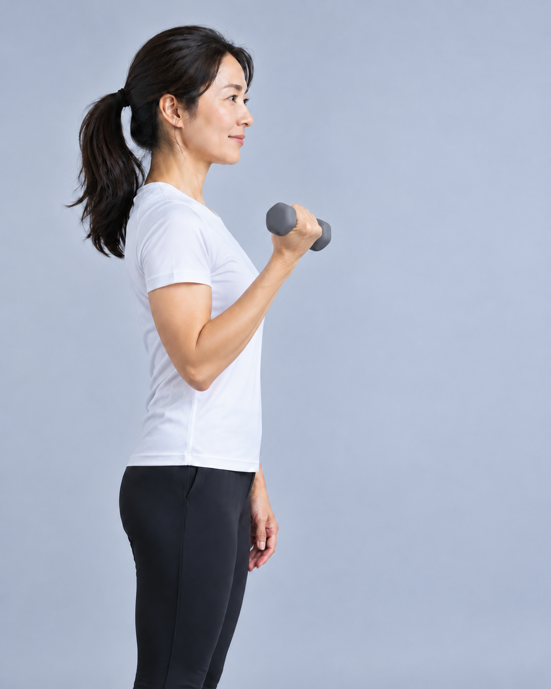
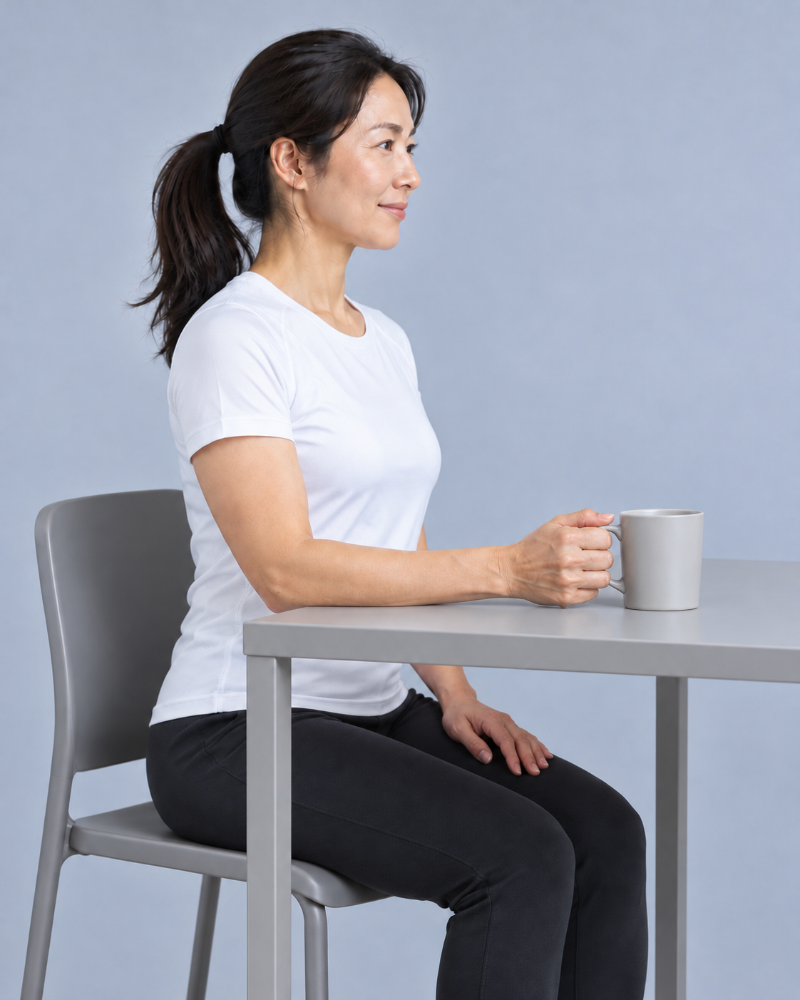
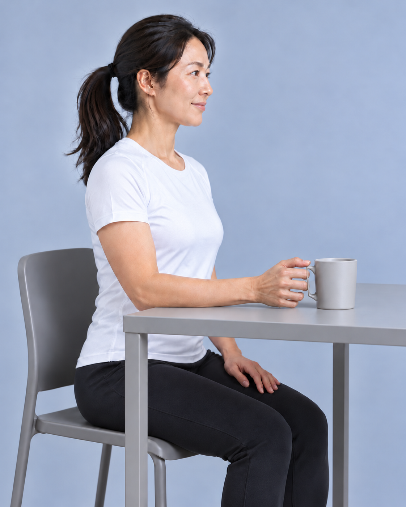
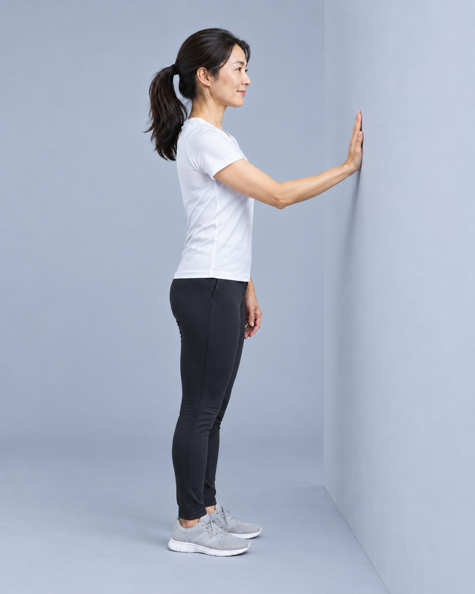
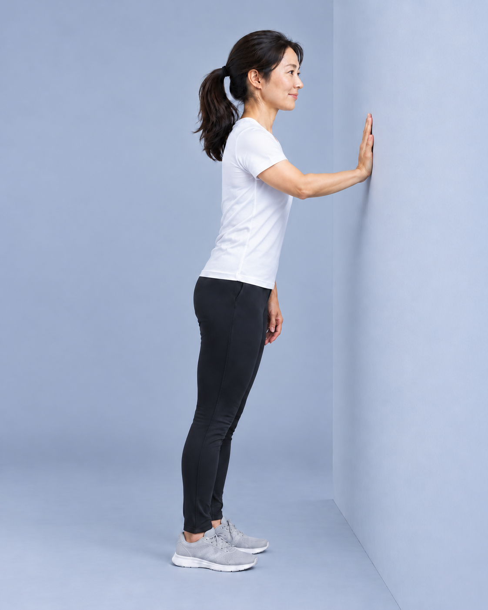
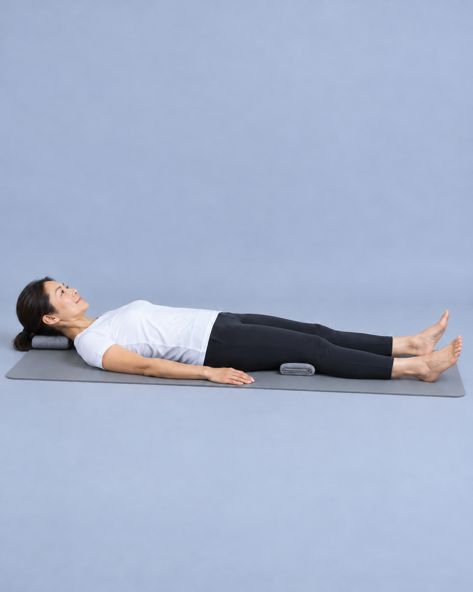
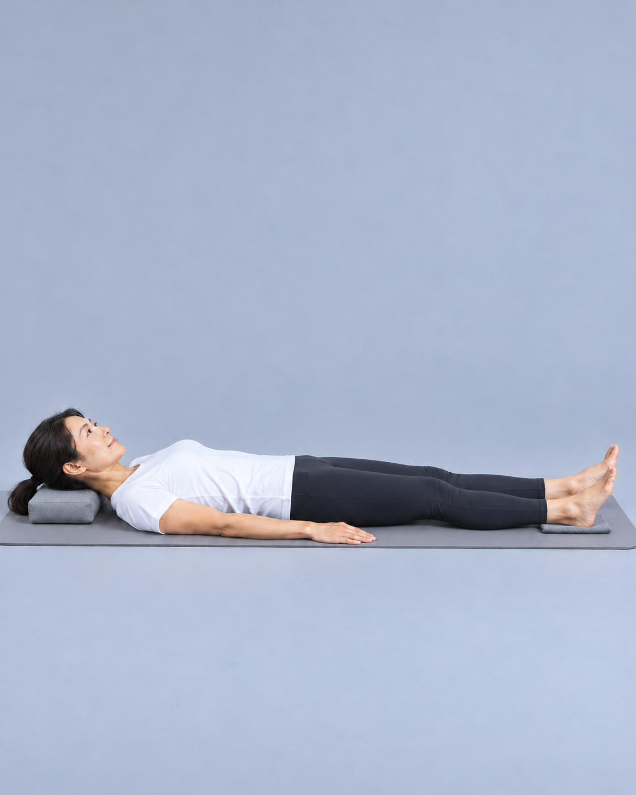
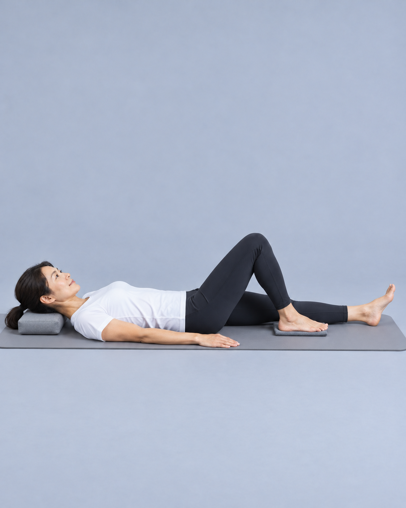
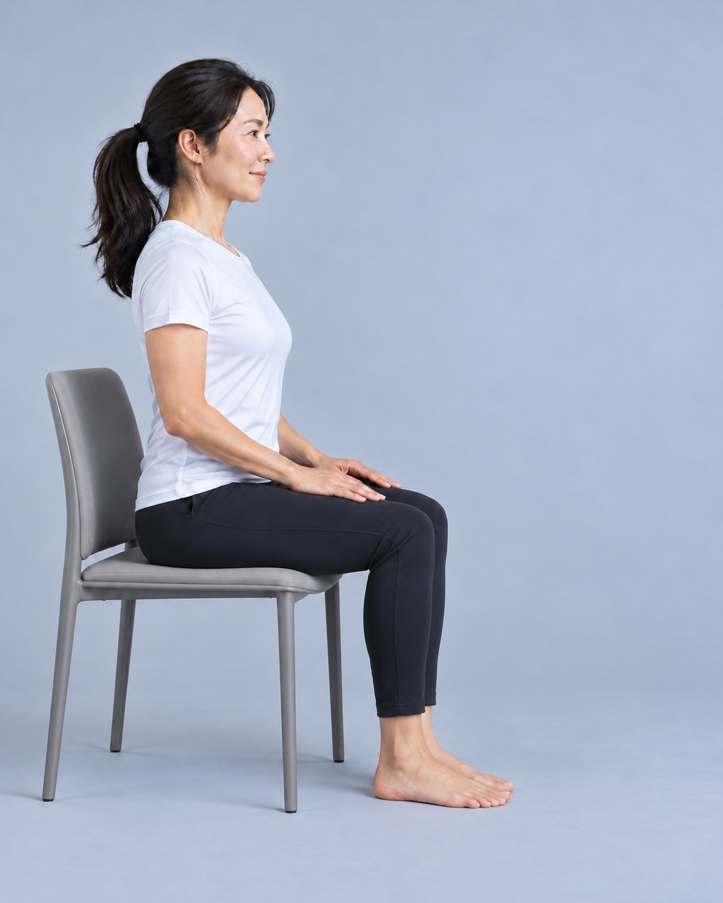

# 第08批：061—066指定步骤示范图

版本v1.0；2026-10-14。用户指定的 **10张画面全部完成：7张由内置image_gen生成，3张复用经实际审查的原图**。这是6项动作中的指定步骤；061仅包含s02，066仅包含s01。

依据：[动作分步骤制作清单](../../动作分步骤示范图制作清单_v1.0.md)。完整最终提示词、来源、逐张检查、尺寸和SHA256见[制作总记录](manifest.json)；生成尝试及修订原因见records目录。选用PNG保持原始像素，文字与箭头留在排版层。

| 图号 | 具体画面 | 选用图片 |
|---|---|---|
| 061-s02 | 已知轻负荷弯举终点：站稳、右上臂靠身、屈肘将小灰哑铃送近肩。复用原图。 |  |
| 062-s01 | 坐稳，右肘与前臂支持桌面，自然腕握灰杯，杯底仍接桌。 |  |
| 062-s02 | 同杯小幅提离桌面、间隙清楚，右肘仍支持、左手留在大腿。 |  |
| 062-s03 | 同杯重新落桌，右手半松握，准备在接桌后松开。采用修订版。 |  |
| 063-s01 | 面墙站稳，单右掌贴墙，肘略屈、左手放松，双脚完整可见。 |  |
| 063-s02 | 掌墙位置与双足站位保持，身体小幅靠墙，前臂趋平、腕背伸变化可辨。采用外部s02_v2。 |  |
| 064-s01 | 仰卧、测试腿舒适伸展，膝下薄毛巾与膝后接触清楚。复用原图。 |  |
| 065-s01 | 仰卧伸腿准备位，测试脚跟落在灰滑布上，躯干安稳。 |  |
| 065-s02 | 同侧脚跟贴面滑向臀部，测试膝弯曲，另一腿伸展。复用原图。 |  |
| 066-s01 | 徒手稳坐，椅面承托大腿，小腿自然下垂，双手安放，小腿与椅架有活动空隙。 |  |

062按01→02→03提放；063与065按01→02→01往返。064用同一图配“放松→收紧→短时保持→放松”的说明，静态照片不证明收缩强度。

逐张已实际查看人物、服装、背景、动作、比例和支撑接触；文件图号、PNG头、尺寸、源图与选用副本SHA256核对一致。065滑布褶边及063部分肢体轮廓存在轻微生成差异，适合动作姿势示范，不用于精确测角或负荷测量。原图、废弃候选与旧口径共享进度保留。

外部选用图仍位于`E:/git冲突问题/rehab image/assess/steps/`和`train/steps/`。本目录为本轮10张选用副本；063外部修订文件名保留`_v2`，对应关系在manifest中记录。外部与仓库制作清单仅来源链接一行不同，各自SHA256均已保存。

本轮为图片资料更新，电脑程序版本仍为0.24.1。图片入口是本总览与本目录；桌面“安康康复（最新版本）”仍由当前仓库`Start-Rehab.ps1`进入程序。此记录不表示这些步骤图已接入正式页面。
