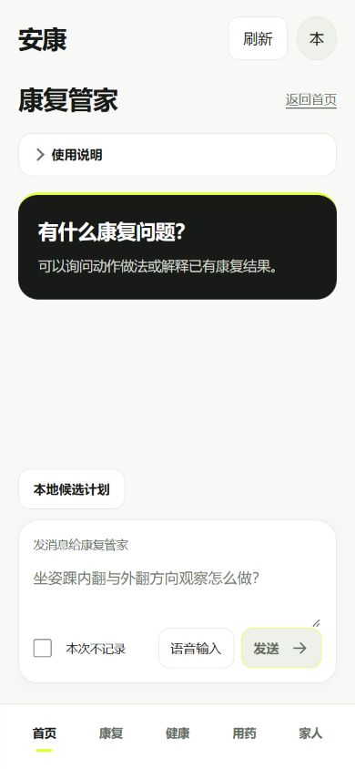
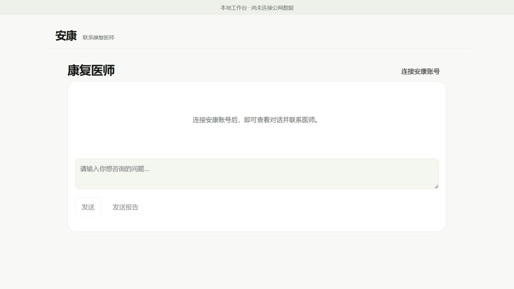

# 康复管家与医患入口配色统一

基准：main `7882a67352ec45288688b2be430f2aa9e92e8eb8`。本轮为录屏前的网页视觉调整，正式实现只修改 `mobile_rehab/static/unified-polish.css`。

## 改动范围

- 沿用现有 APK 的暖白背景、黑色文字与荧光黄绿 `#dfff36`，统一康复管家、患者对话弹窗、配对网页对话框和现有云端患者／医生页面。
- 对话气泡、输入框、主按钮、候选计划弹窗和导航沿用同一组颜色；这些页面在系统深色模式下也保持品牌浅色。
- 修正康复管家输入区遮挡“本地候选计划”的布局；窄屏表单保留原有滚动。
- HTML、JavaScript、API、权限、数据写入和计划校验均未修改。`draft`、`private`、`voice`、`chat-form`、`local-plan`、`dialog` 等原 action ID 保留。
- 未引入新组件依赖。组件发现命令因 registry DNS 不可用未能完成在线预览，采用项目已有原生 textarea/button/dialog；没有声称引入 React Bits 组件。

## 本轮验证

`node --test mobile_rehab/tests/test_unified_presentation.cjs android_offline/tests/workbench.test.cjs public_web/browser-account.test.cjs`：31 项通过，0 失败。

实际浏览器审阅：康复管家 390×844 与 1280×720；候选计划弹窗；输入区聚焦和输入后按钮；患者入口空状态／身份表单；医生登录表单。390px 康复管家文档宽度等于视口宽度，无横向溢出。320px 视口覆盖未实际生效，不记为通过。独立 APK 对话弹窗及登录后的医生患者详情未做本轮真机／真实账号视觉验收。

当前系统深色偏好为 true，页面实际背景为 `rgb(248,249,246)`。康复管家及患者入口浏览器 error 日志为空。颜色计算：黑字／黄绿按钮 15.46:1；次级文字／暖白背景 5.25:1；白字／黑底 17.55:1；焦点线／白底 3.58:1。此为指定颜色对的计算，不代表穷尽所有状态的可访问性审计。

截图使用空白本机档案与新建的隔离空数据库，患者数为 0；未创建患者、消息、报告、费用或调用模型。未操作真实患者数据库，未连接或部署公网服务。

## 构建与交付边界

公开网页资源已用 `tools/cloud/build_public_web.py` 重新生成，61 项资源、2 个页面，清单 `fixture_data_included=false`；生成目录不纳入 Git。

完整 APK 打包未完成：先后遇到测试资料临时路径与跨日种子生成问题；尝试沿用既有 TEST 资料的打包方式被自动审批拒绝，理由是会将虚构资料带入用于录屏的安装包。该方式已停止，未绕过拒绝。现有 APK 未作为本轮更新包交付，也未安装到手机。源码和本地网页预览不等于公网或已安装 APK 已更新。

实际读取并使用的项目 Skills：`ui-polish`（功能冻结、采购与视觉审查）、`frontend-design`（沿用已确定品牌）、`pyside6-fluent-ui`（语义颜色与焦点原则；未修改或声称验收 Qt 界面）。
