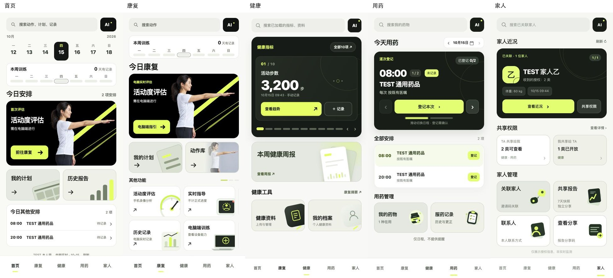
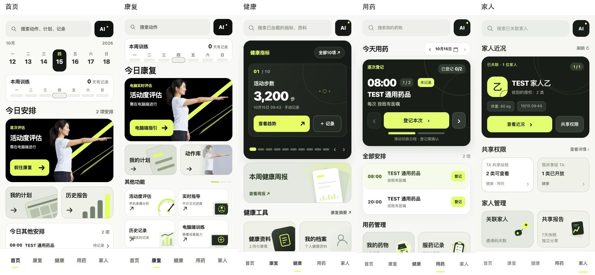
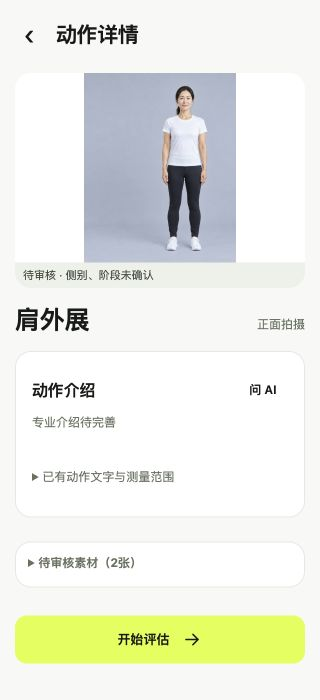

# 移动端 UI 精修与康复候选图片 GitHub 交付验证

日期：2026-10-15。交付分支：`feat/mobile-ui-rehab-assets-integration`。

## 来源与主线保护

从最新 main `cccfd28b68f2e97627f2f7d0ab940f4803105c14` 创建独立 Git worktree，合并本地连续历史：

1. `f5789994ea9290fb68b666ebf4f1f21f7be885f8`：阶段5.3五主页面精修。
2. `47f43b80e84248bc03363e552cb2ba5200c84502`：公共动作资源和候选图片预览。
3. `f433b16f394dbcaf6b71b36b213abe93bce9c61f`：按原字节保留来源CSV，保证恢复校验。

共同祖先为PR #10合并提交`7882a673`。本次未重新开发这两部分，未重复复制已在main的旧UI整合内容。合并无内容冲突；最新main对助手与医患门户配色的4个文件逐字节保留，阶段5.3的10个独立文件精确保留，共用rehab-v51.js与图片阶段版本一致。原开发分支与工作区不改动。

## 资源完整性及医学边界

- 185公共卡原文、656个选用图槽位和656个WebP显示副本都在Git，图片总31,070,630字节（29.6MiB）。原始四ZIP、archive、references及生成中间物不上传。
- 原路径、稳定ID、slot、选用版本/证据、独立图组、原图和显示图SHA256完整保留；052 s02选原版、116 s06选v2，不按时间或最高版本选图。
- 53动作配置完整：25个有候选，其中18可内部封面/详情预览、7有明确冲突仅待审素材区；28手指继续文字。全部pending、patient_enabled=false，实际side/phase和左右六阶段绑定均null；proposed_targets只是审核提议。
- 必须同时具备本地loopback、QA专用标记和主动查询开关才显示新候选；正式服务器没有QA标记，单加参数无法启用。准备、跟练、计次、ROM、评估、计划、保存和权限均未改。
- 显示保持完整源画面、object-fit:contain、不镜像；折叠多图和放大仅供审阅，不是已核验患者教学。
- 本次新增最大文件约1.26MiB，未达GitHub大文件警告阈值，不引入LFS或资源分发改动。所有运行图片真实提交，不是LFS指针或本机外部路径依赖。

## 本轮验证

- 新worktree使用现有锁定QA依赖，重新构建TypeScript bridge成功；TypeScript typecheck通过。
- 前端及医患门户Node测试：130通过。
- TypeScript ProductService/公共康复助手测试：24通过。
- Python统一API、动作定义及图片文字引导回归：217通过，1个真实视频模型用例未运行。
- 本地云端测试：73通过，4个PostgreSQL专用测试因本机无测试Postgres跳过；GitHub现有CI提供Postgres16服务，实际结果以PR检查为准。
- 最新整合程序在真实Codex内置浏览器运行；五页390×844和320×700截图均采集，10页文档宽度等于视口，五文字导航和选中状态正常。内部预览正常，普通入口0个候选图；进入准备页仍0个候选图，原侧别和录像入口存在。
- 656张显示图SHA核对、185卡SHA核对；真实HTTP图片响应及医学隔离另存于交付证据。敏感路径/高置信度密钥特征扫描未发现命中（有界扫描不等于绝对无秘密证明）。

## 截图

## 部署影响与限制

正常Git克隆包含所有显示资源；保持既有/static路径和懒加载，无额外运行依赖。离线重新生成WebP才需要已安装Pillow及保留的原始素材，正常启动不需要原始ZIP/PNG。新机器仍应按现有锁定依赖与build:bridge步骤构建，不能把本机依赖或测试数据库放进交付。

复制整个static目录的Web/APK打包会增加约29.6MiB图片资源。未更新已安装APK、未生成生产包、未部署云服务。没有为此改动Android资源加载方式。

所有候选的本人侧别、体位、机位、起止姿势、辅助器械和医学适用性仍待逐图专业审核。没有真实姿态模型推理或真人准确性验收，既有四项模型环境阻塞未重跑；没有有效计划训练到真实结果反馈的完整真人链路、Android物理触摸或生产环境验证。逻辑/几何回归不等于医学通过。

原始分支、备份和独立恢复目录保留。本次只推送独立分支并创建PR；不合并main。最终远程SHA、干净远程克隆核对及GitHub CI状态见PR与本轮外部交付报告，不提前把未执行CI视为成功。
