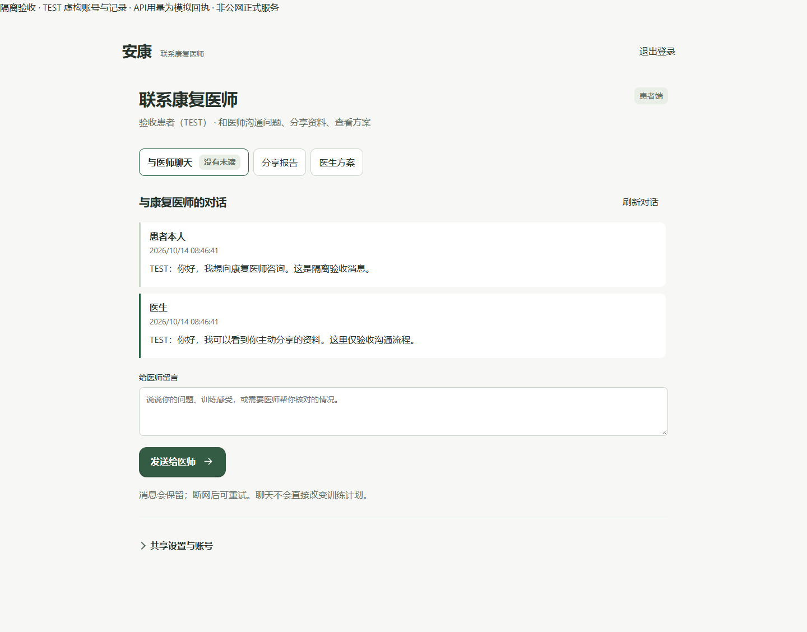
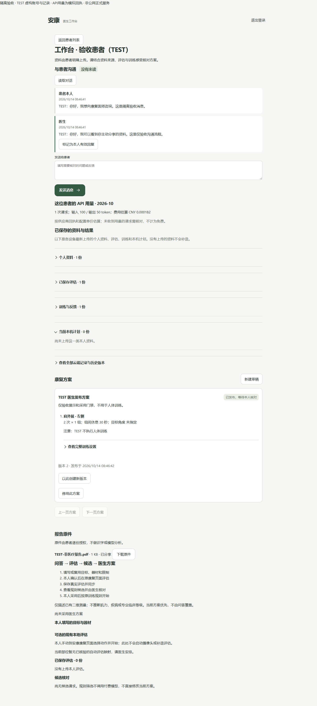
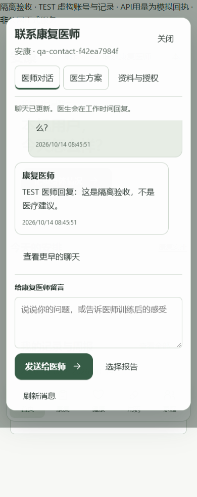
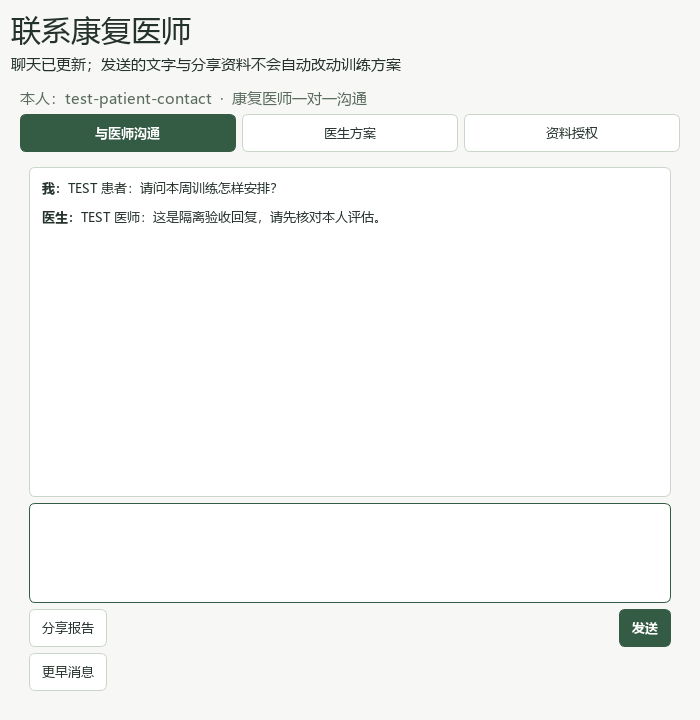

# 患者联系入口与医生工作台验收

日期：2026-10-14。基于 main `4652ef22472f3e53aa282ac721051f553513c874`，电脑 0.25.1、Android 0.5.1/code51、云端 0.3.1/schema3。

## 交付与下架

患者端统一叫“联系康复医师”。桌面保存身份后直接打开聊天；手机、公共网页和电脑配对网页以聊天为默认入口，报告分享、医生方案和资料授权按需打开。患者聊天移除 API 用量、管理控制台和手动调试上传按钮，原身份、同步队列、授权和训练门禁继续使用。后台刷新不禁用正在输入的文字，发送回执仅清除仍与已发送原文一致的内容。

医生在现有 `/care` 工作台查看授权患者、回复、查阅资料和方案；患者详情增加每用户 API 用量与配置价格估算。复用现有账号、权限与数据库，没有重建医生平台。`/account` 为患者联系入口，首次仍需确认身份与资料授权；已保存身份的用户直接进入联系页。

旧患者控制台及依赖旧界面的三个验收脚本从 main 下架，远端完整快照为 `archive/patient-console-20261014` / `4652ef22472f3e53aa282ac721051f553513c874`，详见[恢复索引](../archive/RETIRED_FEATURES.md)。OCR 与旧 Agent 没有恢复。

## 实际验证

| 验证 | 结果 |
| --- | --- |
| 云端及桌面账号／协作 pytest | 93 通过，4 项专用 PostgreSQL 测试本机跳过；CI 单独验证 PostgreSQL |
| Android、公共网页身份队列与门户 Node 规则 | 91/91 通过 |
| 患者／医生独立网页实际浏览器验收 | 12/12 通过，无浏览器错误 |
| 双端全面浏览器验收 | 17 项通过，无浏览器错误 |
| 手机／公共网页新联系页 | 明确首次授权、聊天默认、报告分享、身份与历史刷新保留、离线队列与一次重试、390px 无溢出全部通过 |
| PySide6 实际窗口 | 13 张截图；明暗及高对比主题、520×560 最小窗口、100% 与150%缩放、键盘焦点、保存身份直达聊天、断网重试无重复、离线退出通过 |
| Android 构建 | APK 0.5.1/code51，21,532,621 字节，QA 签名验证通过；未安装真实手机 |

APK SHA256：`c51e962c891cc3356637049611e57e1a005911878996174bd266322de73412c5`。QA 签名不是正式上架签名。

权限检查覆盖账号切换与角色错误入口、明确总授权和单文件授权、撤销后阻断访问、回执丢失与多标签页队列合并、方案草稿患者不可见、缺有效本人评估不能采用。聊天不直接改变训练计划。修正两处测试时间戳夹具，避免结束时间早于开始时间；没有放宽训练规则。

构建 TEST 资料的临时 SQLite 移到系统临时目录的独立 `qa-output/fixture`，仍检查 TEST 标记和空目录，不在同步盘内创建易受同步干扰的临时数据库。正式用户数据库没有改变。

## 截图

以下均为本机隔离 TEST 页面或窗口，不是正式患者资料。网页顶部明确标注“非公网正式服务”。医生用量示例由注入的模拟供应商回执提供：输入100、输出50 token；费率版本 `TEST-MOCK-NOT-A-PRICE`，不代表真实 DeepSeek 价格或账单。

## 复现与边界

`tools/cloud/serve_contact_acceptance.py .runtime/<全新目录> --port 14923` 显式启动回环限定的独立 SQLite、TEST 医患账号、模拟模型回执与验收提示，不读取生产配置，也不包含在云端发布包。患者使用 `http://127.0.0.1:14923/account`，医生使用 `http://localhost:14923/care`，不同主机名隔离会话，可同时打开。TEST 账号为 `acceptance-patient / 1` 与 `doctor / 1`，仅这个隔离脚本创建。

浏览器脚本为 `verify_patient_portal.cjs`、`verify_patient_contact.cjs`、`verify_workbench_browser.cjs`；桌面脚本为 `verify_patient_qt.py`，均在 `tools/cloud/`。本机原始日志和结果在 `.runtime/contact-pytest-final.log`、`contact-node-final.log`、`contact-portal-final-06/`、`contact-mobile-final-04/`、`workbench-two-entry-ui-20261014-02/` 与 `patient-contact-qt-20261014-release/`，不放进发布包。

公网服务器未部署、生产数据库未修改、未操作真实患者数据。正式工作台不自动生成 TEST 账号。上线仍需独立部署验收；本轮没有替代真人训练、真实手机硬件、真实供应商账单或并发容量测试。
