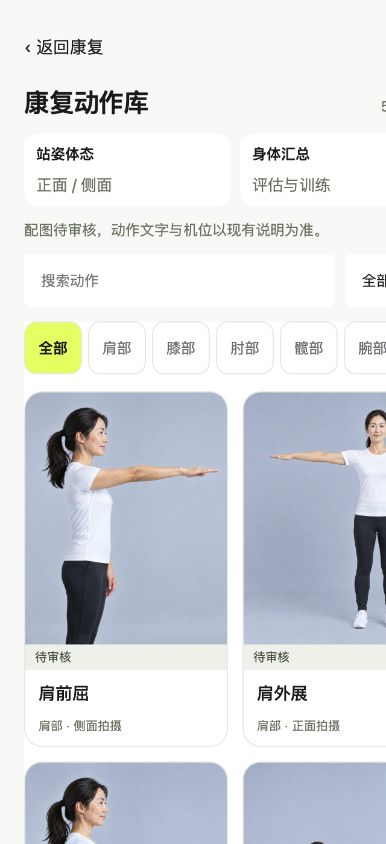
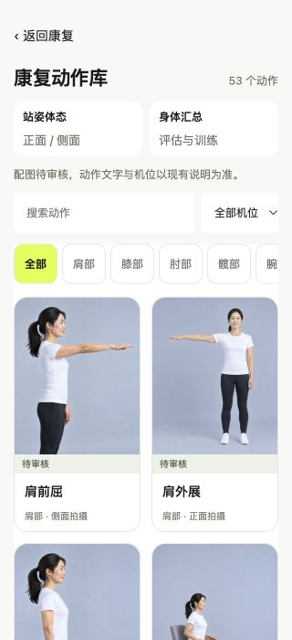

# 动作库正式入口配图展示（2026-10-15）

基线为PR #11合并后的main `d425e5e59b7be3c2680ec74a5dc34ef4abedf609`。用户本轮明确要求照片直接展示在正常康复动作库，参考所附两列图片卡片；不再要求这些目录配图局限内部TEST入口。

## 修改

- 新增独立`catalog-display.json`，明确选择18个无已知映射冲突动作的封面slot。肩前屈和肩外展分别选用048 s02、049 s02的原图，未镜像；没有自动选版本或推断本人侧别。
- 普通已连接移动Web的动作库和动作详情直接显示这18项，不依赖loopback/内部标记/预览参数；同动作多图及放大可用。7个明确冲突仍仅内部完整资源审阅，28个无精确图片不借图。
- 动作库图片宽度100%、高度按原图自适应，图片容器零内边距，不用cover、不拉伸；横图/竖图保留本来的比例。图片贴卡片边缘、圆角裁边只约束卡片范围，不裁掉身体或必要器械。不同画幅卡片允许高度不同，避免为了等高产生白边。
- 保留两列布局、分类、机位、53个动作及API，沿用原颜色、字体、圆角和返回路径。图片区外保留小型待审核标识。
- `exercise-mapping.json`、`resource-index.json`和全部656个WebP逐字节未改。`review_status=pending`、临床侧别/阶段绑定和`patient_enabled=false`不代表目录隐藏，仍表示医学核验/临床阶段指导未获确认。目录展示配置与医学绑定分开。
- 准备、训练、计划、ROM、计次、反馈、授权和后端未修改；其他四个栏目未修改。图片不改变现有动作说明及机位要求。

## 验证

真实浏览器在390×844与320×700检查：53个动作、18项配图，页面宽度等于视口；图片自然比例、零内边距，无横向溢出，首行与用户参考对应。28项手指无借图；正面机位筛出8项；肩外展搜索、详情、多图放大和返回正常。准备页侧别/视频按钮保留，未开启摄像头或运行模型。浏览器无捕获的warning/error。

前端/门户132项通过；Python统一API及动作指导68项通过，1项真实空视频测试按已知缺少本地YOLO权重的环境条件未运行，未改断言或下载模型。18个封面真实HTTP200及响应SHA通过，656张展示图SHA全部匹配。没有进行真机、生产部署或医学准确性审核。

原main和原开发分支保留。本轮在`feat/rehab-library-photos`独立分支提交，不自动合并main。

