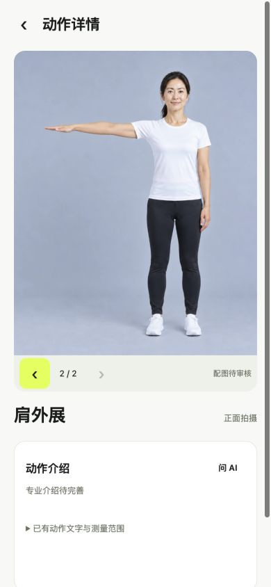
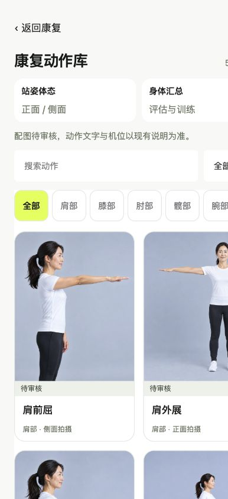

# 动作库大图轮播与最后一张封面（2026-10-15）

基于main `8f1fc2c706504f4119fb9bad984ab9ded87aa86d`，独立分支`feat/rehab-photo-carousel`。

## 行为

- 正常动作库18个有图动作的封面，统一取该动作已有候选列表的最后一张；按明确slot写入目录展示配置，不按修改时间或最高版本选图。原有有图优先排序不变，53个动作完整保留。
- 点击动作卡进入原动作详情，顶部大图汇集该动作全部关联图片，默认显示与封面相同的最后一张。左右原生横向滚动、上一张/下一张按钮及方向键/Home/End均可切换；当前张数实时更新，有边界禁用状态，支持减少动态效果。
- 删除原独立“待审核素材”折叠区及孤立的旧gallery渲染代码。图片下只保留轻量审核状态；可点击当前图片放大，关闭后保持当前图片。
- 18动作共38个关联图位（35个唯一文件）；每个动作的2–3张图均在主图轮播中，无丢失。图片宽度贴合容器、原比例高度，不裁切或镜像；横图保持横图比例。
- 7个明确冲突动作不强行作为正确动作配图，28个缺图动作保留文字回退；内部完整资源审阅器仍保留，具体映射问题、来源与提议保存在原JSON/CSV。

## 边界

原`exercise-mapping.json`、`resource-index.json`和656张WebP内容未改变。所有医学审核状态、临床左右侧/start/move/return绑定保持原值；图片张数不是医学步骤。未修改API、后端、算法、训练/评估、计划、反馈、权限、其他四个栏目及已有返回流程。本次没有新增医学指导或启用临床功能。

## 验证

前端/门户135项通过。新专项覆盖全部18个最后一张封面、38个关联图位、主图首尾/键盘/禁用状态与减少动态效果。全部656图SHA匹配、38次关联图片HTTP200及SHA通过，浏览器实际18个封面src与配置完全一致。

真实Codex内置浏览器390×844、320×700：正常入口无测试开关；两图动作的原生横向滚动来回切换、按钮、键盘、三图动作Home/End/中间图、放大关闭、搜索返回正常；390切320保留当前最后一张，横图290×193保持1200×800比例，无页面横向溢出，无旧独立折叠区，捕获控制台warning/error为0。未测试物理触屏、Android真机或模型推理。本轮未重复运行未修改后端的Python全量测试。

原main与开发分支保留；本次不自动合并main、不发布生产或APK。

