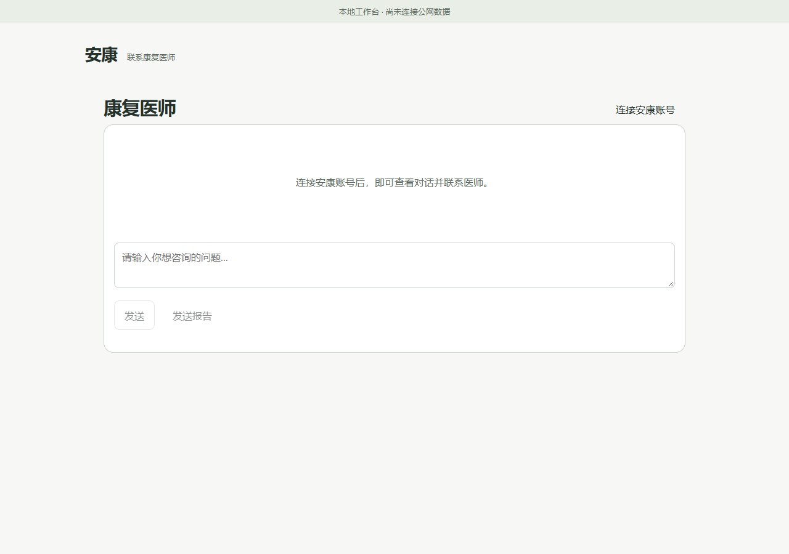
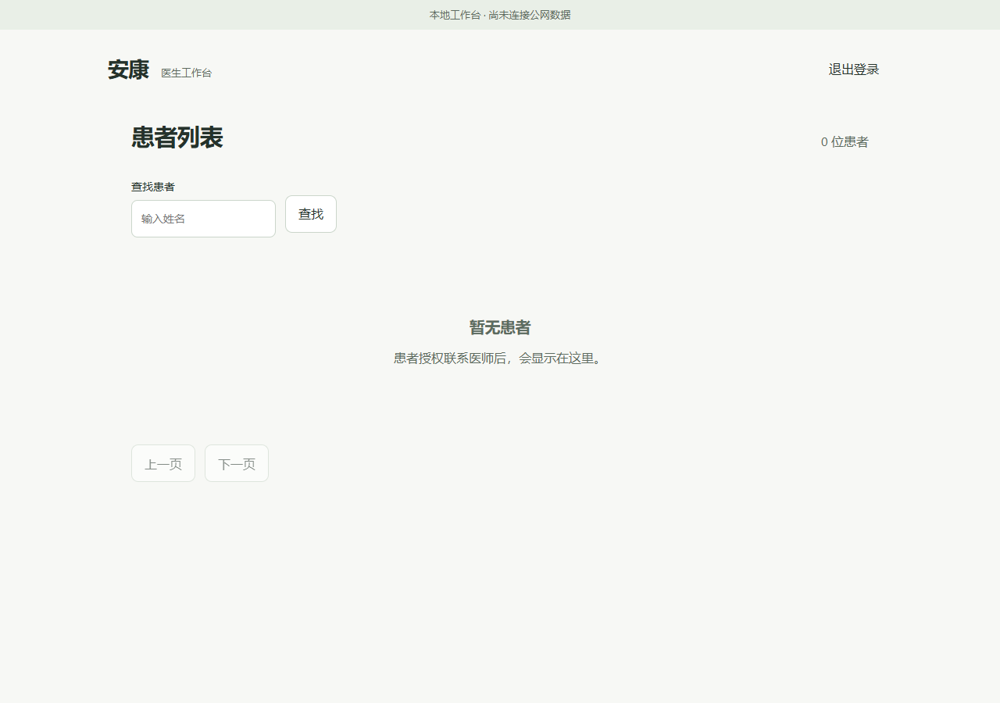

# 简洁医患工作台

基于 main `ba859d88b79f64797c7dbb33ebf4096c4b8f31df`。电脑0.25.2、Android0.5.2/code52、云端0.3.2/schema3。本轮只简化既有医患入口，没有重建医生平台、扩展新模块或更新公网。

## 界面

- 医生打开 `/care` 就是患者列表。选择患者后只有“患者信息、沟通、API 用量”三个页签。
- 患者信息包含已授权资料、评估／训练记录、报告和康复计划；计划草稿、发布及采用门禁继续使用。首页不再堆放队列、工作日历、用量看板或问答候选流程。
- 患者在原安康中打开客服式聊天，输入、报告和发送在底部；医生方案和授权收进“更多”。保存身份直接恢复，首次未连接时按需展开账号连接，不生成患者身份。
- 医生在信息或用量页不会把未查看的消息标成已读。消息两端按当前身份区分“我／患者／康复医师”。
- 配对网页修复回执丢失后自动重试成功仍被旧待发状态阻挡的问题；仅在成功确认原操作后释放，保留后来编辑的新文字。

## 没有演示数据的用户页面

旧生成患者与模拟模型回执的启动器从 main 下架，完整旧版保存在 `archive/complex-care-ui-20261014` / `ba859d88b79f64797c7dbb33ebf4096c4b8f31df`。旧14923演示进程已停止。

`tools/cloud/serve_local_workbench.py .runtime/<全新目录> --port 14924` 仅监听回环地址，以开发配置创建独立空 SQLite，不读取生产配置、不注入模型回执，也不创建患者、聊天或报告。它只为操作者初始化本地管理员，随机口令以 Windows 当前用户 DPAPI 加密保存；统一模型关闭。此本机辅助脚本不包含在云端发布包中。

实际给用户打开的14924环境核对：患者0、消息0、计划0、模型回执0。患者窗口不代注册账号；医生窗口显示空列表。顶部“尚未连接公网数据”明确说明状态，空列表不能解释成线上没有患者。

## 验证结果

| 检查 | 实际结果 |
| --- | --- |
| 云端及患者账号／协作 pytest | 93通过、4项专用PostgreSQL本机跳过，由CI独立验证 |
| Android与公共网页规则 | 92/92通过（含未知用量／部分计价检查） |
| 简洁双端实际浏览器 | 14/14通过；页签互斥、正确作者、信息／用量页不标读、权限撤回；无JS错误 |
| 完整双端实际浏览器 | 19/19通过；跨页队列竞态、回执丢失、草稿冲突、发布、缺评估禁止采用与撤权；无JS错误 |
| 手机实际浏览器 | 390px底部输入可见、无横向溢出、明确授权、原件分享、双向消息、刷新保留、断网仅一次重试通过；无JS错误 |
| 配对网页实际DOM专项 | 回执丢失后确认原操作，保留新输入并允许下一条消息，原消息不重复，通过 |
| Qt实际窗口 | 100%与150%分别13张截图，明暗／高对比、520×560小窗、更多次页、身份恢复、离线退出、队列零重复，通过 |
| 无种子空环境核对 | 真实空状态截图、患者与模型回执均0，不调用模型，不创建患者 |

APK 0.5.2/code52 QA签名构建并验证成功，21,532,621字节，SHA256 `03d5d820205f2b057c9c4e244e4e1cac74efe84dcf3c5a7280e43e5ce09bb18d`；未安装手机。

原始验证位于忽略目录：`.runtime/simple-care-pytest-final.log`、`simple-care-node-final.log`、`simple-portal-browser-20261014-02/`、`simple-workbench-browser-20261014-04/`、`simple-contact-mobile-browser-02/`、`simple-patient-qt-20261014-02/`、`simple-patient-qt-20261014-150/`、`simple-empty-workbench-20261014/`。配对专项命令：`node tools/cloud/verify_patient_contact.cjs --paired-only`。内部自动测试使用另一个隔离环境的测试记录，不写入用户空页面，不向用户交付这些测试患者截图。最终完整手机脚本一次复跑触发独立QA注册限流；没有弱化限流，手机全流程与新增配对专项分别验证通过。

公网未部署，生产数据库、患者原始数据和真实模型账单均未操作。当前源码完成不代表现有公网平台已更新。独立验收不替代真人训练、手机硬件或线上并发检查。
