# 五模块全局验收与PR截图

产品代码验收基线：8381d413b9fe58234696b5cf78c8bd1a885da3cd。此资料仅补充审核文档和真实截图，不改变产品代码。

阶段5.0复用了阶段4.6同提交的真实Chromium截图，并补跑联合检查：前端205、TypeScript471、领域服务24、移动Python121、云端Python73、医患客户端/会话来源/恢复与手机宿主23，共917项通过、6项跳过，另24项家庭/独立报告真实API检查通过。TypeScript编译及安全检查通过。

新浏览器联合检查覆盖390×844、320×700五文字导航、页面切换和资源，首页到康复任务/服药登记，指标0真实保存、AI预填隐私与返回，服药主动选择与首页同步。医患双向消息、医生三标签/未读边界及报告撤销保留同提交实际浏览器证据。

只使用隔离TEST数据。四项姿态模型测试缺YOLO11n-pose权重，保留既有失败证据，没有弱化断言；专用PostgreSQL、Windows加密/原生宿主、实体Android、生产部署、摄像头与付费模型未验。v2默认关闭。AI不代替专业评估；未经核验动作图片不作标准示教。

本轮新增已确认P0/P1/P2/P3均为0；结论限验收范围，不代表未验证环境已经通过。后续视觉精修需单独批准。

截图为已保存的同提交真实运行证据，并非原型或本轮重新渲染。390×844/320×700 Chrome PNG采用DPR2；其原始像素为780×1688/640×1400。来源与文件完整性由截图SHA256.json记录。

## 首页

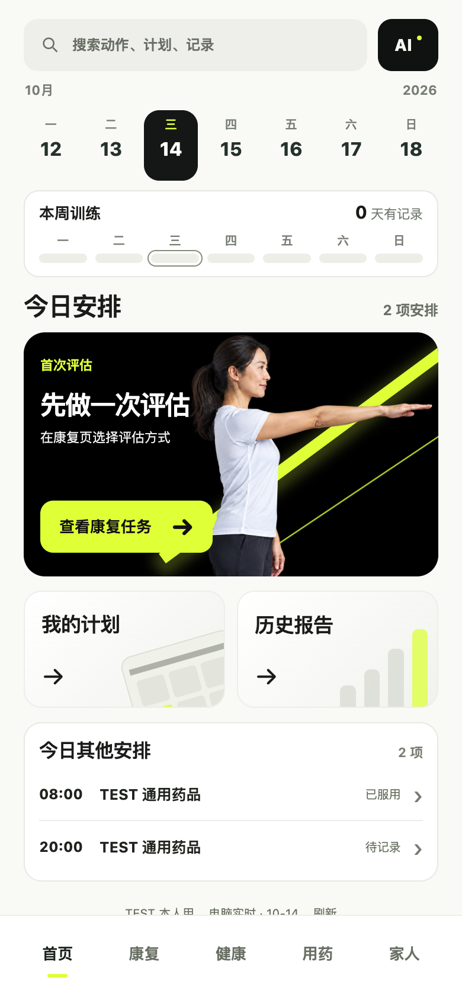

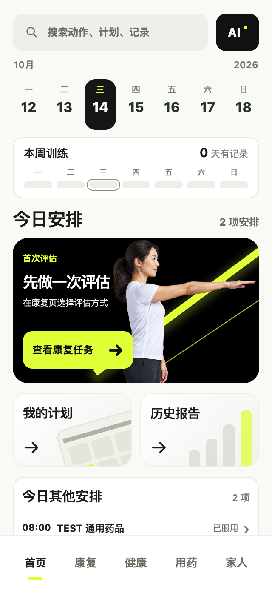

## 康复

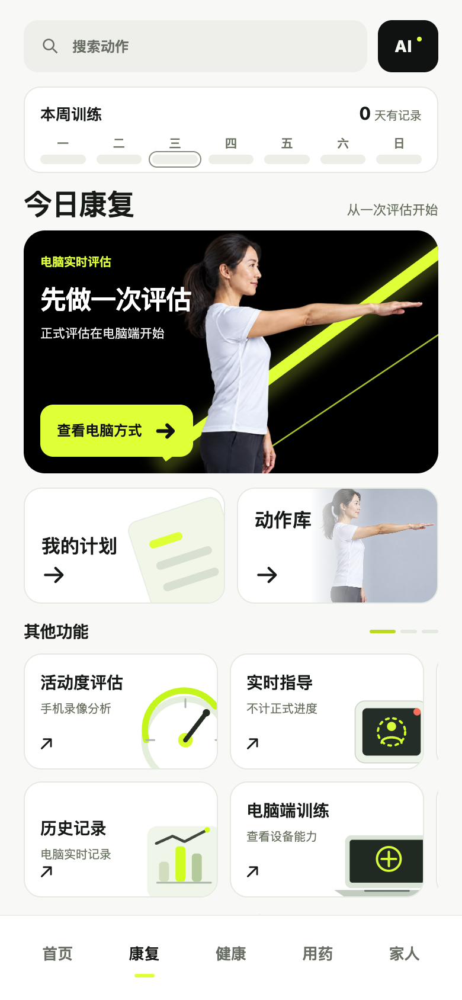

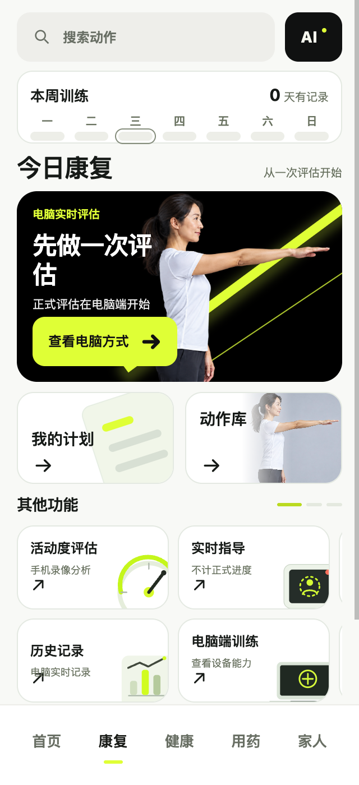

## 健康

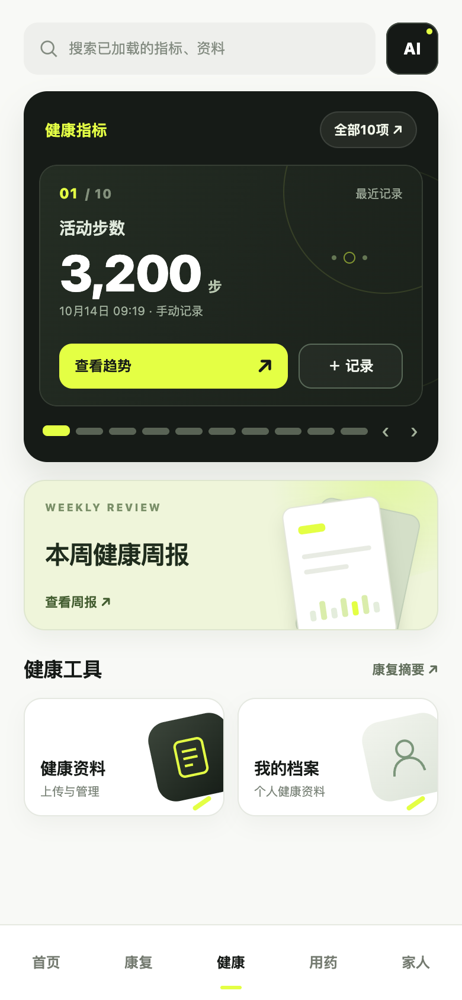

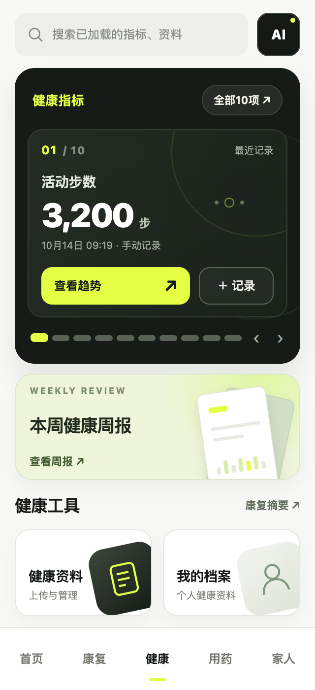

## 用药

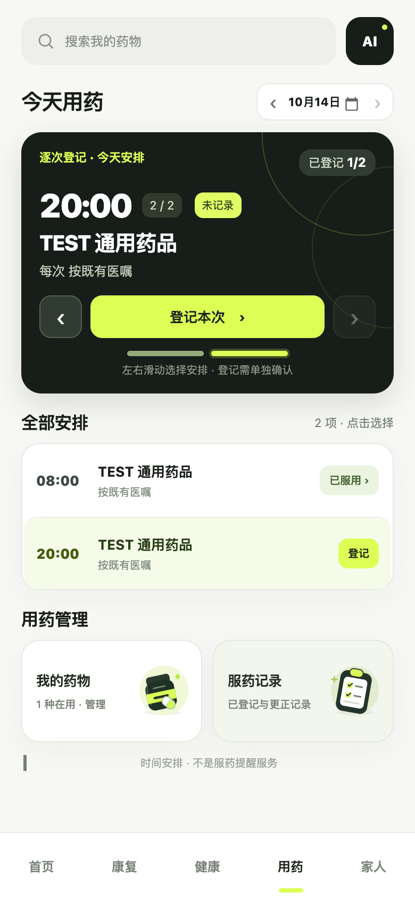

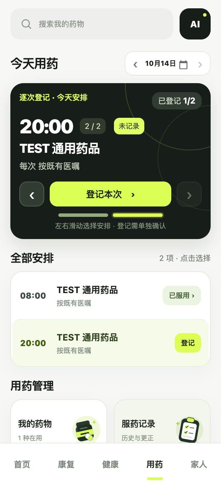

## 家人

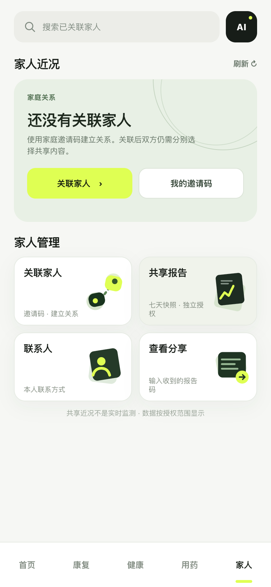

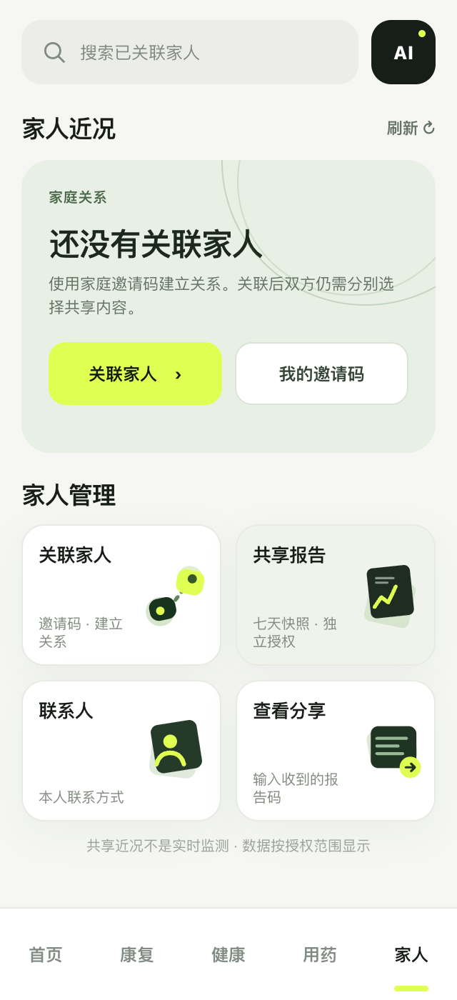

## 最新main医患协作

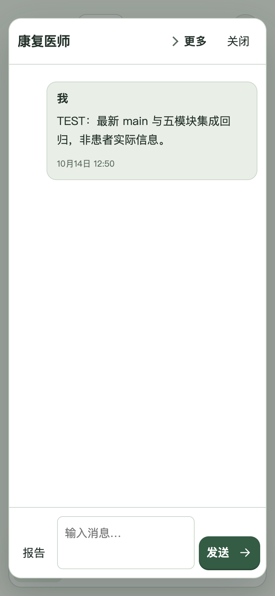

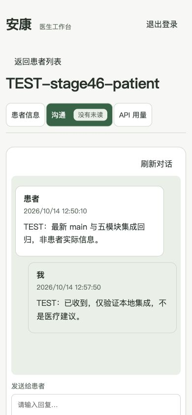
