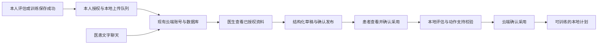

# 安康工作台

患者在原安康软件中打开“联系康复医师”，已保存身份时直接进入聊天；医生在原管理网页 `/care` 使用独立“医生工作台”，查看授权患者、回复和每用户 API 用量。`/account` 是患者联系入口。复用云分支 `codex/unified-cloud-service` 的账号、会话、医生授权和数据库。公网服务未部署，合入代码不会自动更新服务器。

医生首页只有患者列表与搜索。点击患者后，详情固定为“患者信息、沟通、API 用量”三个页签，默认打开信息；只有实际打开沟通才清除已读。康复计划与报告位于患者信息，不再在首页堆放用量看板、待回复队列、工作日历或候选流程。

患者入口为客服式聊天，输入、发送和报告在底部；医生方案与授权在“更多”。首次身份连接按需展开，保存身份后直接恢复对话。没有患者、记录或用量时显示空状态或未知值，不预置演示内容。

## 使用流程

1. 患者登录云账号，核对本机本人档案的归属，开启康复记录同步，并授权医生查看。
2. 本人评估或训练保存成功后，客户端把结果放入本地上传队列。医生查看已收到的个人康复资料、评估、训练与反馈、当前本地计划。缺测保持缺测，零次数保持零，不上传录像原件、图片附件、家庭成员资料或 AI 对话。
3. 患者与医生在工作台单独发送文字。聊天有历史、未读和待发状态；发送操作有稳定编号，断网或收到回执前中断时可以重试，服务器不会重复保存同一操作。
4. 医生从当前软件支持的动作中选择动作、侧别和训练设置，保存草稿，核对后发布。修改已发布方案会创建新草稿，保留旧发布版本。
5. 患者查看完整安排，点击采用。客户端核对本人最新有效评估、动作契约和训练支持范围；云端确认后才启用为本地可训练计划。没有有效评估时先补测。开始训练还要经过原来的评估与训练检查、机位准备和本人确认。

聊天消息不会执行训练计划修改。普通 AI 问答、动作解释与本地候选清单沿用 main，报告 OCR 与旧 Agent 代操作继续退役。

## 主要代码

| 内容 | 仓库路径 |
| --- | --- |
| 原账号、授权、不可变上传事件 | `cloud_service/app.py`、`security.py`、`database.py` |
| 记录修订、最新结果视图、文字消息、计划发布与采用 | `cloud_service/workbench.py` |
| 当前 53 个实际可测动作的支持清单 | `cloud_service/exercises.json`；`tools/cloud/build_workbench_catalogue.py` 从原 `app/exercises.py` 生成 |
| 原医生网页的工作台扩展 | `cloud_service/static/index.html`、`portal.js`、`portal.css` |
| 电脑账号、队列、记录同步、方案本地核验 | `rehab_codex_single_camera_v2_1/app/cloud_account.py`、`app/ui/cloud_account.py` |
| 电脑自动同步、配对网页固定本人宿主 | `app/ui/product_window.py`、`app/product/backend.py`、`mobile_rehab/unified.py` |
| 手机账号与加密原生传输 | `android_offline/src/cn/tele/rehabilitation/offline/AccountTransport.java`、`MainActivity.java` |
| 手机与公共网页版联系入口、队列、消息、方案采用 | `android_offline/web/patient-contact.js`、`contact.css`、`account.js`、`store.js`、`local-api.js`；`public_web/browser-account.js` |

共用资料库的 185 张评估和训练卡仍供问答查询；医生可执行计划必须映射到实际 53 个软件动作。未支持的卡片不能仅凭名称变成可执行项目。

## API 与数据约定

接口前缀 `/api/cloud/v1`。浏览器复用 HttpOnly 会话、CSRF 与同源检查；原生客户端复用 Bearer 会话、刷新与设备撤销。注册只能创建患者账号。当前复用的医生身份为现有共享 `DOCTOR_ADMIN`，本轮没有扩展多医生分诊或机构权限。

| 接口 | 用途 |
| --- | --- |
| `PUT /patients/{id}/doctor-access` | 患者授权／撤回；检查授权版本 |
| `POST /patients/{id}/record-events` | 患者上传本人已保存事实；原事件永久保留，`record_key + revision` 形成修订视图 |
| `GET /patients/{id}/rehab-summary`、`records/latest` | 医生或患者查看当前已收到的评估、训练、资料与计划 |
| `GET/POST /patients/{id}/messages` | 分页历史与发送；发送请求包含 `operation_id` |
| `POST /patients/{id}/messages/read` | 持久化各账号读游标；只标记已收到的序号 |
| `GET /care/actions` | 医生查询实际支持动作与规范设置 |
| `GET/POST /patients/{id}/plans`、`PUT /plans/{plan_id}` | 患者只看发布版本；医生创建／修改草稿 |
| `POST /patients/{id}/plans/{plan_id}/publish` | 核验动作与设置，确认发布不可变版本 |
| `GET /patients/{id}/plans/current`、`POST /plans/{plan_id}/accept` | 查看采用状态；患者提交本地规则核验回执，检查发布版本与当前采用版本 |

上传来源和本地核验回执均为客户端声明，服务器不把它们包装成真实测量认证、医生身份资质认证或临床有效性证明。患者原始记录不由医生改写；医生写自己的消息和计划。每次请求重新检查患者范围和医生授权。

## 隔离验证与已有服务器更新

本机浏览器 QA 用 `tools/cloud/serve_browser_qa.py .runtime/<新目录> --port 14910`，只监听 `127.0.0.1`，显式使用独立测试 SQLite 和虚构医生账号。端到端脚本 `tools/cloud/verify_workbench_browser.cjs` 仅允许回环地址。云测试 `cloud_service/tests/test_postgres.py` 只允许专用数据库名 `ankang_cloud_qa`；CI 创建临时 PostgreSQL 服务，与现有公网数据库无连接。

当前云 schema 为 3，保留原账号、授权及上传历史，增补消息、读游标、草稿／发布、当前采用指针、幂等操作、上传修订、报告分享及模型回执计费。`Database.migrate()` 只在显式迁移时执行，应用启动不擅自升级数据库。以后经授权更新现有服务器时，应先做原有加密备份，在隔离库验证恢复和迁移，再为既有运行账号授予新增表权限；不重复运行新服务器初始化、账号重建或数据种子脚本。旧加密备份恢复检查继续接受旧 schema。

最新简洁界面与空状态见[简洁工作台验收](../validation/SIMPLE_WORKBENCH_2026-10-14.md)，核心协作原始记录见[工作台验收](../validation/WORKBENCH_2026-10-13.md)。开源借鉴的取舍与许可证见[参考记录](OPEN_SOURCE_REFERENCES.md)。
