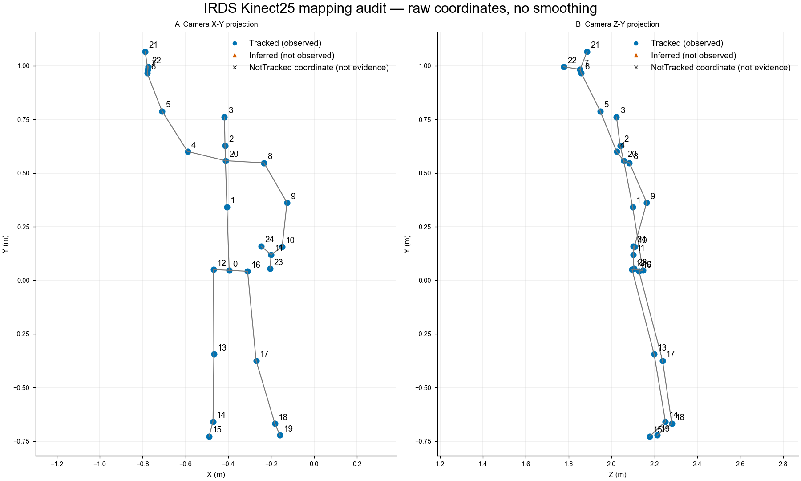

# 康复后端实施与真实训练：阶段记录与增量交付

> 2026-10-12新增B3.21：原RGB→原YOLO／原协议→实际预测／trace→保存证据重放。固定5人val＋5人test全部执行／重放一致，9233完整展示帧／1161采样帧，但全部WAIT_READY、准备未成立、0确认次；这是必须保留的负结果，不是人体准确率或产品发布。原权重／规则／患者库／客户端均不改，0专业GT与默认空间不足仍在。

> 本轮最终外盘完整545／12／19及1308保护全部通过，250相关源前后不变；原E盘490空间失败和旧手机507不覆盖，默认生产容量未恢复。下文原B3.20的523通过、B3.19的490失败、D1的456描述均为各自历史时点，不能当本轮或人体验收。

> 2026-10-12当前增量B3.20：参考到计次／相位评价接通离线工具，33专项通过；真实24份仍0GT，未生成准确率。D盘新隔离完整523／12／19及1308保护全部通过，246份相关源码前后不变。原E盘490空间失败、旧手机7个507与D盘旧子集保留，默认生产容量未恢复；预测导出仅声明，专业参考与手机／LAN／TLS等仍未完成。下面较早阶段的“当前／最新”依该阶段阅读，不替代本次或临床验收。

> 2026-10-12当前增量：B3.19独立专业标注链。最终34项专项通过，24段真实RGB仍0真值。最终完整`verification-e8c8c33f`490项有4个真实空间预检错误、旧手机19项中7项507；原康复12项及1308保护通过。D盘真实容量下30项姿态工程＋19项旧手机子集通过，不替代完整回归。生产门槛、源／正常库、UI／APK均不变。后面的早期“最新456”等为原阶段记录，不是当前全量通过；整个任务仍未完成。

日期：2026-10-11（Asia/Shanghai）。第一阶段实施基准：`b6d22fc392915738401fe6e14d9cc32b877a5acc`，提交`1463929`；所属推理／诊断`129e5cb`，报告隔离`06366bd`，时间／贡献`23696de`，原生存储`a9e31cc`，关键点工具`bf698a3`，VIDEO对照`d0b21d2`，双层masked loss`d5c351f`，显式续训`1a4dd43`，显式安排交付`fc8ba23`。时间比较阶段以`fc8ba232e82bf13582ae317bef4ef408d2d07337`为基准，最新真实HTTP恢复以`1fd6806666d4f41cb6b235d4f99d95154b7611b5`为基准，源码以本文件所在提交为准。任务依据：本机`docs/安康康复训练后端实施与训练任务书.md`。产品仍0.20.0、APK0.2.1，协议`rehab-protocol-2.0`，不是新客户端发布。

结论：P0–P4核心链路与一部分P7已有实际证据。IRDS真实获许可数据上训练两个模型，候选未优于简单基线。B3.17已下载MobiPhysio3.0的24人／24段RGB，完成原YOLO提取与整视频EAAQ质量实验；Ridge／TCN没有优于训练分数中位数常量。B3.18补HTTP时钟诊断和独立断流用例，该阶段完整456／12／19通过；旧455项失败原记录保留，根因未证明，不能说已修复人体漏计。当前B3.19的34项标注专项通过，但24份仍0真值；最终完整490受实际存储条件阻断，D盘子集通过不替代全套验收。正式会话仍独立opt-in，未成为现有UI/APK路径；P5／P6缺独立目标2D／visibility／相位／可观察完成参考，未完成合格真人微调或影子上线。整个任务未完成，不能宣称真人准确度提高或产品发布。

已有增量接通唯一贡献、最终历史、原继续政策、冻结计划、显式时间、所属推理／报告、SQLite故障边界、关键点工具、同权重Python VIDEO、双层masked loss和条件式多轮优化。资源双锁／报告延期见B3.6，显式恢复／CPU数值／原子写见B3.7，三动作安排见B3.8，时间比较见B3.9，采样见B3.10，持续输入／冷启动见B3.11–12，三窗口退出见B3.13，Windows保护见B3.14，HTTP恢复见B3.15，发布评分见B3.16，真实RGB质量实验见B3.17。各阶段计数不累加；没有目标域角度／计次准确率或保持时间真值。最新新增仅离线工具／数据配置／TEST探针／报告／必要文档，生产服务、算法、规则、权重、患者库和整个客户端不改；没有再次分析私人原片。

## A. 实际完成情况

当前最新基准为f113d9d，详见B3.21。[实际回放](temporal_replay_verification.json)10段原模型／原协议执行和保存证据重放一致，但全部WAIT_READY、0确认次，无人体真值评价；[本轮外盘完整回归](storage_full_regression.json)545／12／19及1308保护全部通过，250相关源不变。22专项是545子集，默认容量未恢复，所有原失败／旧阶段结果保留。

最新增量基准`101c69f309909a74cdd3c0da470064faeeff4a24`，见B3.20。[D盘实际完整回归](storage_full_regression.json)为523／12／19及1308保护通过；33项评价专项是523子集，246相关源SHA不变。[原默认E盘完整回归](regression.json)490项／4空间错误、旧手机7个507保留为失败，原30／19子集单列不替代全量；默认容量未恢复。34项标注、33项评价是不同阶段的工程检查，真实24人仍0真值。既有487／456通过和455失败均保留，不相加、不抹去失败。RGB实验仍以`d18bd57`及逐源码SHA为基准，视频质量负结果和旧HTTP根因未证明保持；本轮不训练真实候选、不重跑私人原片，无手机／LAN／TLS或临床准确性新增验收。

| 工作 | 状态 | 实际证据 | 剩余限制 |
| --- | --- | --- | --- |
| P0 盘点与保护 | done | [开工清单](../rehab_backend_inventory.md)、[1308 文件基准](protected_files.json)、[末次 hash 核验](scope_verification.json) | 仅本轮范围；不代表其他会话或临床验收 |
| P1 三动作后端协议 | done（工程定义） | `app/rehab_v2/protocols.py`、`engine.py`、`rounds.py`；15 项协议回放及几何契约测试 | 定义是二维投影和训练观察，不是解剖 ROM 金标准；实际机位仍由计划给出 |
| P2 正式会话与幂等 | partial | 既有SQL冻结／202／最终事务／重试、真实TCP丢响应及Windows退出对账；B3.18阶段456项通过，另真实接收断流保存半次 | 原455失败无逐帧证据，根因未证明；当前全量存储失败另列P7；旧UI／APK未接入，真人计时与完整故障待做 |
| P3 IRDS 下载与适配 | done | 198,985,485 字节骨架 ZIP、1974 字节 readme；CRC/MD5/SHA 校验；534 条/29 人，532 训练资格、2 隔离 | Kinect25 三维肩外展，不是手机 RGB、坐站或深蹲标签 |
| P3 RGB候选前置 | done（限定队列） | Mobi3.0／CC0、3008组评分核对；E01／AF／VFL的24段680355016字节全部校验、14／5／5人固定划分 | 非完整数据集；视频评分不等于逐帧关节／相位，SUMedi资格未验收 |
| P4 模型训练 | done（离线实验） | [实验包摘要](experiment_summary.json)，两次完整训练链结果；检查点、验证/测试预测和锁文件均存在于忽略目录 | TCN 测试 macro-F1 低于 logistic；只整次正误，不可作为相位/提示/诊断 |
| P5 真人目标域验证 | partial | 原RGB／视频EAAQ实验；双人标注／导入、[评价工具](temporal_evaluation_verification.json)、[10段原RGB实际回放及保存重放](temporal_replay_verification.json) | 24份仍0真值；10段均WAIT_READY、0确认次，不能称精度通过；尚非正式患者会话trace的通用导出器 |
| P6 姿态微调 | partial；缺独立监督 | 转换、双层loss、多轮与续训工具；合法RGB及视频质量训练已完成，[监督门](pose_supervision_blocker.json)仍拒绝pose／phase训练 | 缺独立2D／visibility／相位与同集点误差基线；未做真人姿态微调、不自动上线 |
| 候选后端接入 | offline / off | [冻结模型对照](model_comparison.json)，Kinect 匹配返回非权威候选，RGB 被拒绝 | 未在实际服务加载新权重，没有正式质量判断/提示接管 |
| P7 回归与交付 | partial | [本轮D盘完整545／12／19](storage_full_regression.json)、[原E盘490失败](regression.json)、旧子集及既有HTTP／Windows／SQL／采样证据；250源及原1308保护不变 | 外盘完整通过不恢复默认E盘容量；真人参考、手机／LAN／TLS、多客户端、长时及完整物理故障仍缺 |
| 禁改范围 | pass | 1308个protected文件SHA256一致，原baseline不重建；本次正式产品源码不改，只有离线工具／数据配置／测试／报告／文档 | 原280份动作图片、脚本、CSV、任务书仍原样保留、不纳入本次提交 |

## B. 修改清单：问题、实现与验证

### B3.21 实际原RGB到计次预测及保存证据重放（2026-10-12）

以f113d9d继续任务书10.4–10.6／15.2／P5。上一轮预测只有声明式manifest；旧特征缓存未保留原完整人／框／track，不能补框／固定伪身份当真实流程。

新增`temporal_replay.py`、`replay-mobiphysio-temporal`、专项verifier和13＋9项TEST。明确原下载receipt／split／分析侧／新run；运行前冻结原plan、采样和配置，从真实容器PTS／完整展示帧经原所属YOLO进程、源像素映射、原因果adapter／engine，保存每帧人／框／轨迹、指标／阶段前后／确认次数／事件。只导出出程、回程和COMPLETE结束确认，准备与峰区起止null，不反推阶段，不用人工表或视频总分，不写正常库。

实际`temporal-replay-audit-ed5fca84`原CC0队列val5／test5完成，分别3688／5545完整展示帧、466／695采样、462／624主指标可观察；CLI64.763／76.240秒含源核验，不是手机或实时性能。原模型释放确认，33相关源码及原标注包不变。再次从保存原姿态重算全部指标／协议、采样清单、事件、最终结果和manifest，10段一致；summary SHA5cc9060237f45c762fe4010eaae6baa86bc719bf5be363dfe360b38bcb8e6104。

负结果：1161采样帧全WAIT_READY、没有准备基线、0确认次／出程／回程／完成事件。没有改规则使结果“通过”，不能由0推断真人没做动作或确定漏计根因。侧别在推理前固定为left，患侧未知；不得拿test挑较好的侧或采样／门槛。需独立val参考区分准备、采样、取景及协议影响。

13项导出语义TEST通过；9项证据TEST首次在本机C盘满写夹具时OSError28，原输出48cb2e保留，显式D盘隔离temp重跑9项／0.373秒通过，不放宽门或删文件。测试包括hash改写后的伪计数／指标／模型、漏样本、旧源码、释放不确认；这些夹具不是模型或人体GT。

最终D盘完整`temporal-replay-full-20261012-a9309b72`实际545项／209.476秒、原康复12／0.087秒、旧手机19／12.02秒及1308保护全部通过；250相关源前后不变，原默认失败summary／日志不变。新summary SHAcf06e156c172f2eef441dd8cd04ccdbfc8e04b143abdc14bc8608fa1ccc96167；22专项是545子集，不相加。当前[完整聚合](storage_full_regression.json)引用这一新run，原523完整通过保留原run／SHA，不覆盖失败或默认生产空间门，default_product_storage_restored=false。

边界：当前仍0专业参考，不做准确性评价、姿态微调／候选上线、剂量变更或手机／LAN／TLS／长时实机验收；只这个固定肩外展研究队列，坐站／深蹲真实独立参考仍缺。方法见[工作流](../../docs/development/REHAB_TEMPORAL_REPLAY.md)、[本机记录](../../docs/validation/REHAB_TEMPORAL_REPLAY_2026-10-12.md)与[聚合](temporal_replay_verification.json)。全部原阶段成功／失败保留，整个目标未完成。

### B3.20 专业参考到计次／相位评价及完整工程回归（2026-10-12）

问题：上轮仅能导入参考，没有用于独立计数／边界比较的消费者；原E盘容量不足，只有D盘子集通过，不能覆盖全量验证。

实现：新增`temporal_evaluation.py`、CLI和33项TEST，参考重新绑定当前独立复核；完整所选split队列、source／侧别／协议／时钟、逐任务可用性不可丢。计数已知且预测可用才算误差，空／未知不是0；同种边界用有序一对一最大匹配再最小时间差，与小规模穷举对照。缺标不当负例，未匹配不明预测为unassessable，精确率附保守下界；全部人群／pending／excluded与覆盖保留。声明式预测出处不能证明执行，不接正式trace、库、剂量或模型启用。

实际专项`temporal-evaluation-audit-8badfb07`33项／0.292秒、help和真实待标包拒绝均按预期；24份仍0GT、未生成evaluation，原包不变。summary SHA为95045e5bda49e5ea9299db6bbf30c30fe0ca6e5f96375aad0168f9512656439c。初次扩展33项的一个TEST共享对象问题修夹具后重验，开发失败保留说明，不放宽生产校验。

完整回归：`verify_storage_recheck.py --suite full`与verify_all复用全部四组；实际D盘`temporal-full-20261012-45ade789`523项／204.622秒、旧康复12／0.087秒、旧手机19／12.42秒、1308保护全部通过。246相关源SHA不变，实际起始空闲16103366656字节，原失败summary／日志不改。新完整summary SHA为150c4b9abba050f0c67b980f87550ef93d066fc33c2aab9365eda075bb6e38ae；单列[完整聚合](storage_full_regression.json)，不覆盖原E盘失败或子集。没有disk_usage mock、生产门槛变化、数据迁移或用户文件删除；默认E盘容量未恢复，警告不通过升级依赖抹去。

边界：无真实GT结果、质量／提示效果／物理完成混淆或受试者CI；P5／P6仍未完成，手机／LAN／TLS、长时与全部物理故障待做。详见[工作流](../../docs/development/REHAB_TEMPORAL_EVALUATION.md)、[本机记录](../../docs/validation/REHAB_TEMPORAL_EVALUATION_2026-10-12.md)及[专项聚合](temporal_evaluation_verification.json)。所有原阶段记录保持，不把工具成功写成人体收益。

### B3.19 独立专业标注、复核与参考导入（2026-10-12）

问题：有合法RGB／视频总分，但缺独立相位、可观察完成与质量参考；原模板没有可执行的双人标注／第三人复核导入链。按任务书10.4–10.6／13继续，而不是重新训练没有对应监督的头。

实现：离线`professional_annotations.py`、CLI三命令、TEST契约与`verify_professional_annotations.py`；新v2标签逐边界、问题及可评价性mask，source／split／时间不能改；双人独立声明和第三人资格／分歧／canonical输入digest绑定。部分合格参考保留完整原队列、pending和excluded，不将它们变成阴性。原v1和原视频EAAQ实验不改，新参考不提供pose监督、不上线、不写正常历史。

实际：`professional-annotation-audit-3581f13f`34项TEST退出0；固定Mobi3.0／CC0的24人24段原视频、680355016字节、14／5／5人复核与真实PTS生成通过。24份A／B／REVIEW各为空标注，approved=0、known_labels=0，空导入拒绝且未创建输出；三种TEST篡改被拒绝，原包和1308保护不变。summary SHA为`ebb1e831bdaf2b8cc8d304f999dc730b05605b255a01ab767eb8cc8649f25318`。原片仅引用，不复制、下载、推理或训练。前三轮27／31／33项保留，不相加。显式独立审查的0次参考在TEST可导入，空表／unknown不自动变0；单帧不能证明完整往返。

边界：人工独立性／资格尚未实际组织，不能凭三字符串宣告真值。当前仅同视频可见物理参考；同步外部参考及干预回执仍需资格适配。坐站／康复深蹲条件素材、独立点／visibility和真实相位仍缺，P5／P6仍partial，整个任务未完成。细节见[规范](../../docs/development/REHAB_PROFESSIONAL_ANNOTATION.md)、[本轮验收](../../docs/validation/REHAB_PROFESSIONAL_ANNOTATION_2026-10-12.md)与[聚合证据](professional_annotation_verification.json)。

全量失败与替代验证：最后490项四个pose工程用例在实际512MiB预检前被拒绝，旧手机七个用例在真实Jobs容量门返回507，原日志和hash保留。仅用显式D盘新TEST目录重验整份pose工程30项和旧手机19项，全部通过、1308保护不变；D盘起始实际空闲16105250816字节，无disk_usage mock、不改生产阈值、不搬数据、不删文件。`verify_storage_recheck.py`与[聚合证据](storage_recheck_verification.json)记录原失败绑定和新环境；不能据此宣称默认E盘已恢复或最终全量通过。

### B1. 动作、观测、组次与提示

新增 `rehab_codex_single_camera_v2_1/app/rehab_v2/`：`__init__.py`、`protocols.py`、`evidence.py`、`engine.py`、`rounds.py`、`cues.py`、`temporal.py`、`sessions.py`、`compatibility.py`，本次补 `progress.py`、`timing.py`。

| 问题 | 实现 | 新行为 | 验证 |
| --- | --- | --- | --- |
| 肩主角度受腕/髋缺失阻断 | 复用 PoseAnalyzer 的肩肘图像垂直角；可选质量指标独立 mask | 肩肘有效可测；腕缺失肘质量 unknown，髋缺失不补造躯干质量 | C01 |
| 稳定站姿被当坐姿基线 | 协议起点同时要求姿势和持续稳定，坐站以膝屈曲观察坐姿 | 站着进入不计起立；站立后必须再观察坐回才能重装下一次 | C04/C05 |
| 遮挡/旧帧/预测补次 | 每指标 observed/computed/age/joints/kind；源 epoch、单调 seq/time、模型/几何契约门控 | 缺测不累积保持；隐藏转折只能 partial/UNASSESSABLE；预测不授权确认 | C02/C03/C08/C09 |
| 恢复后平滑器被旧结果污染 | 姿态推理与 EMA 分离；检查控制 epoch 后才更新 EMA，恢复重置滤波；gap边界沿用计划 | 暂停期间返回的旧推理不会更新相位、次数或平滑状态 | C08 慢推理故障注入 |
| 深蹲以髋高度替代膝角 | 直接采用 `180°−膝内角`；没有髋/膝/踝时该指标不可用 | 浅屈膝完成次数与个人幅度目标分开，非健身深度分数 | C06 |
| 组次/休息与视觉次数混在一起 | TrainingRounds 只编排明示的 reps/sets/rest，不生成新剂量 | 坐站到站立计次，但坐回后才结束组；休息/暂停不计；恢复核对给定休息 | C10 |
| 历史错误不断触发提示 | 当前有效质量约束与已完成次的历史问题分离，复用原 GuidancePolicy | 一条当前事件，证据引用、相位/epoch/TTL、取消；动作改善后旧纠正取消 | C11；取消/发出写审计 |
| 新视频被当作不能比较 | compatibility 与具体 evidence_fingerprint 分开 | 新 session/job/source identity 本身不阻断绝对投影角比较；相对幅度仍保留基线条件 | `test_contracts.py` |
| 明确节奏安排被 v2 拒绝 | 复用原 MovementTiming 和 timing_for_plan，加版本／时间基准／证据封套 | 出程、回程、保持与计次独立；缺测不补时间，完整往返后才做峰区分段 | `test_timing.py` 12 项，含持久化 |
| 坐站回坐时间未同步逐次表 | 同事务同步草稿时间扩展，同时校验已确认计次事实不可改 | 站起仍计一次；坐回时间在终结前补齐，终结后快照／回执不重写 | 时间持久化、重开、篡改回滚测试 |
| 覆盖新待处理帧污染较早在途帧 | 丢帧按 seq 前缀兑现，期间隐藏实时保持提示 | 旧有效帧可处理，下一幸存帧不得跨丢帧累计保持；隐藏转折不补次 | latest-frame replacement 时间回放 |

没有改原 `runtime.py`、`quality.py`、`rehab.py`、`training.py`、`guidance.py`、`storage.py` 或域对象。新路径组合原组件；旧引擎保持原结果。没有增加处方、继续资格或训练剂量决策。

### B2. 会话与数据库

新增 `mobile_rehab/rehab_v2/{__init__,api,service}.py`。现有 `server.py` 只在显式 v2 块增加安装、计划解析／查询及关闭回收；默认不启用。新宿主解析现有本人自动或手动保存计划的 ID、revision、entry_key、证据引用和已有资格，不接受用户关键点来伪造相机观测。手动计划复用 prepare_training_plan／validate_saved_binding，要求 training_plan_confirmed；安排要求陪同时另需 companion_confirmed，不让请求覆盖原剂量／节奏。

新增 namespace 表：`rehab_v2_meta/sessions/operations/frames/repetitions/audit/feedback/reports`，本次加 `rehab_v2_plan_contributions`，namespace 从 1 迁移到 2。使用原 Storage 的数据库 owning thread；原 `PRAGMA user_version=4` 不改。迁移前用 SQLite backup 保留一致副本；v1 最终事实回填贡献但不重写原回执／视觉快照。实际宿主 v2 使用独立 `rehab-v2.sqlite3`，不把测试写进正常患者库。

事实链：认证本人 → 查创建幂等记录 → 核验现有计划/明示剂量与节奏 → 冻结计划与来源 → JPEG原模型推理 → 逐次检查点及时间更新 → 控制 revision → 冻结接收边界 → 有界收尾 → 单事务最终逐次事实/快照/回执/唯一贡献 → 独立派生报告 → 追加反馈及审计 → 本人最终历史／原政策进度查询。

- 创建、frame event/seq、操作键和 repetition index 有 SQL 唯一性；同键改载荷冲突。已提交/正在执行的重复请求先查回执，再检查新前置条件。
- 并发不同 finish key 只能得到一个 commit_id；accepted/processed/persisted seq 分开，丢帧/超时未处理逐项记证据，terminal 之后晚结果不修改快照。
- 逐次确认增量保存；实际子进程 `os._exit(27)` 后重开保留1确认次，未确认半次保留为无法评价并终结 interrupted，不能 resume 已 finalized。
- 解码/推理异常明确保存 frame failed，终结input_failed，而非永远留在准备中。持久化自身不可用不能保证写下失败事实；本轮原生SQLite故障退出消费者并保留固定运行态故障，物理介质故障仍待验收。
- 报告生成异步，不延迟最终回执；pending/failed 可在重启对账。反馈 revision CAS 防止旧报告覆盖新反馈。报告失败不会倒退已保存事实。
- feedback missing/null 保持缺失；自报不会改原视觉快照，反馈追加不重复增加执行量。
- 本次新回执标记 `unique_v2_contribution_committed`；唯一贡献与最终事实同事务，故障注入证明贡献失败一起回滚。旧回执保留其原标记。本人最终历史按 ordinal 游标分页，单页 1–100；计划查询只取当前版本最新条目尝试，并在同人／来源／情境／动作／侧别范围读取跨计划反馈。复用 `general-activity-rules-1`，不写旧测量，不把 v2 质量解释成旧 ROM。现有历史页面和 `/api/plan` 仍未接入。

### B2.1 最新所属推理进程与诊断（本轮）

新增 `mobile_rehab/rehab_v2/pose_worker.py`，只复用原 VisionWorker／YOLO 的解码和推理，宿主仍负责时间、EMA、状态机、SQL 和原继续政策。512 KiB JPEG + 4 MiB 姿态 JSON 的共享内存只由父进程拥有；≤4 KiB 的管道通知不传外部 Python 对象。父进程核对载荷 hash、ticket、完整 Context、seq、源时间和有限耗时，再检查控制／终结 epoch，才处理 EMA。启动握手／冷推理／热推理预算 10／30／5 秒；只释放准确所属对象，未确认退出时隔离并保留清理句柄，不能另起泄漏进程。成功后清空传输区，失败后确认退出再清理；不宣称存活模型 RAM 全部擦除。Process.start 本身尚未有 OS 级硬截止。

帧消费者因持久化故障退出后，来源运行态failure可查，新帧／新建返回503，不能虚构失败已保存。终结先保存事实，再取消该sid在途推理；旧失败不能结束恢复后的新control_epoch。关闭若资源仍未确认释放则明确失败，后续可再关闭，不提前释放lease。本次默认报告隔离见B2.2；可信本地callable仍为线程，真实磁盘满／损坏尚未完成，OSError注入仅证明对应故障路径。

新增 `app/rehab_v2/telemetry.py` 与认证诊断路由。服务端 trace_id 放入 source 元数据，创建重试／重开稳定，不加入客户端幂等摘要；JPEG 会话 `job_id=null`。每个固定阶段保留 512 个耗时、事件尾部 128 条；计数累计，分位数为保留窗口 nearest-rank。队列／解码／推理／IPC往返／特征／规则／指导／检查点／控制／最终提交／报告／结果年龄分别统计，旧 commit_ms 数组只是检查点兼容，不称最终提交。关闭候选不伪造 temporal 耗时，未知 RSS／重启统计保持 null。只有所属会话鉴权后可读，不含原媒体、骨架、用户原话、owner 或凭证；诊断不参与测量、计划或最终事实摘要。

新增 `tests/rehab_backend/test_isolation.py`（17 项）、`test_telemetry.py`（9 项），扩展真实 JPEG 与身份 HTTP 测试，CLI 会话集纳入两者。新增 `tools/rehab_ml/session_benchmark.py`／`benchmark-sessions` 和 [性能摘要](session_performance.json)。实际测试覆盖真实所属挂起／退出、共享区容量与 hash、取消后不重开旧帧、释放未确认后重试、失败检查点拒收、报告慢任务不阻断控制、统计有界／并发／未知和正式事实不变。

### B2.2 本次默认派生报告所属进程

新增 `app/rehab_v2/reporting.py`、`mobile_rehab/rehab_v2/report_worker.py`与共用`owned_worker.py`。报告保持原10字段，不接LLM／新处方／新质量规则。仅已finalized的本人白名单快照进入单槽；2 MiB输入＋2 MiB响应、≤4 KiB通知，默认握手10秒／工作5秒／terminate及kill各等待1秒。子进程无相机／SQL，宿主校验SHA、ticket、sid、反馈revision类型和值、输入hash、有限compute_ms及原事实报告digest，再用旧反馈CAS提交。初始实际执行契约写入source；本地callable钩子明确为trusted_local_callable且无硬取消，不作为公共请求配置。

报告超时／退出只写派生失败；事实、canonical_commit、唯一贡献不变。重试／重开可重建；busy返回running且不写失败。共享区成功后清空，失败确认所属退出后清理，释放未确认保留句柄和存储lease并允许重试关闭。SQL派生写失败在backend_execution／diagnostics可查，pending保持可恢复，不能声称故障已保存。新增report_compute_ms、report_roundtrip_ms及report_timeout／cancelled／busy；整次report_ms还包含宿主核对和写入。RSS只对本sid实际在途报告读取，空闲／未知为null。

18项专测包括纯默认构建和传输复用、容量／身份／内容篡改、真挂起与退出、超时取消、清理未确认、关闭释放与重开补建、反馈CAS、并发busy、鉴权、草稿拒绝、本地钩子关闭失败和受控SQL错误。没有真实磁盘故障、真人准确性、手机或全负载证明；OS Process.start本身与宿主序列化／纯核对没有单独硬截止，不称整个报告链绝对实时。

### B2.3 本轮原生 SQLite 故障边界

新增`RehabStorageBoundary`，只适配原Storage owning thread，不加连接／队列／写入器。初始化后busy_timeout250ms，按实际sqlite_errorcode分类容量、只读、锁、损坏、I/O及打不开；原业务约束和SQL代码错误不转换。固定HTTP503附不确定提交语义，无SQL／私密路径／伪回执；恢复后查commit再用原键重试。损坏原件保留，不自动重建。检查点存储失败与input_failed分开，停止消费者且确认所属资源释放；最后观察故障只在运行态，不冒充数据库健康或已保存。

12项实际SQLite测试使用E盘小型TEST库：mode=ro／query_only、外部BEGIN IMMEDIATE写锁、max_page_count与256KiB事务内分配、损坏副本文件头、SQLite Backup API恢复到新路径。验证最终事实／报告／贡献事务回滚、控制和反馈不推进、恢复后幂等重试、派生报告重建、损坏文件不覆盖、检查点失败拒收及HTTP边界。物理磁盘没有被占满，NOTADB副本不是B-tree或介质损坏，已知备份不恢复未存在事实；IOERR／CANTOPEN本轮没有硬件故障实测。

此前同代码完整130／12／19项及CLI100项日志已核对，本轮另存储12项／12.689秒通过。命令、初期游标清理失败及fetchone修复、日志SHA和范围见 [存储验收](../../docs/validation/REHAB_V2_NATIVE_STORAGE_2026-10-11.md)。正式UI／APK／旧Storage实现／非康复不改，v2默认关闭。SQLite锁等待预算不等于整个请求、Future或初始化硬截止。

### B3. 数据与实验工具（第一阶段，保留）

新增 `tools/rehab_ml/`：common、inventory、download、data、features、models、training、benchmark、target_domain、model_registry、visual_audit、crash_probe、summarize_target、run_minimal、verify_all、cli及README。新增 `configs/rehab_ml/{datasets,baseline,tcn,backend}.yaml` 和 `annotation-template.json`。

新增 `tests/rehab_backend/{test_protocols,test_sessions,test_api,test_contracts,test_ml}.py`，本次补 `test_progress.py`、`test_timing.py`。报告为本目录及 `reports/rehab_backend_inventory.md`，交接更新在 `docs/HANDOFF.md`。

下载器校验固定版本/字节/MD5，.part续传，206核对偏移；200不追加旧片段，完整损坏文件隔离，最终原子更名。ZIP检查目录穿越、链接、体积/文件数、压缩比、Windows保留名及大小写别名，CRC实际通过。原始数据/模型不提交Git。

标注模板分开物理完成、可观察完成、阶段、错误、提示机会、专业复核、训练授权和各任务mask；unknown没有被编码为正确或负例。第一阶段姿态CLI只有资格检查；本轮转换、旧模型预测与独立误差评估已实际实现，见B3.1，`train-pose`仍明确拒绝且不算完整训练链。

### B3.1 RGB 关键点转换与独立参考评估（bf698a3交付）

新增`pose_dataset.py`、`pose_inference.py`、`verify_pose_tools.py`、30项`test_pose_dataset.py`和`pose-reference-template.json`；扩展CLI／target_domain监督记录，不改正式运行路径。参考清单校验权限文件、原图hash／尺寸／EXIF、COCO17左右顺序、匿名人／录制／帧／时间、独立人工复核与完整人体框；人员、录制和同图hash不能跨train／val／test。输出只新建于忽略的实验data／run目录，不覆盖已有产物。

`build-pose-dataset --reference`分别导出masked原值及坐标／objectness双mask，或完整17点的YOLO标签＋YAML＋provenance。锁定Ultralytics8.3.199的loss表明未标点写0仍进入objectness BCE，所以部分标注拒绝stock YOLO格式，不补零或筛走缺标样本；明确不可定位的人工0另行处理。三份TEST导出通过该版本`verify_image_label`真实解析，前后hash一致；格式通过不授予训练资格。

`infer-pose-reference`复用原manifest／权重hash、所属spawn YOLO／CPU640／容量和取消机制，不接相机或SQL。原图不缩放，但明确重编码quality95 JPEG，两个hash分别保存；按参考框唯一IoU匹配，不匹配或多候选不产有效点。每张图重置context，不是连续tracker或无辅助端到端验收。

`evaluate-pose`核对清单／图片／人物／录制／帧序／源时间及预测格式；像素欧氏误差和bbox对角线归一误差只对有效覆盖点计算，缺预测仍计覆盖／PCK_all分母；空参考或空覆盖保持null。输出逐关节／人／动作／视角／visibility分层、逐点证据、疑似左右交换及有限样本roundtrip分位数；不是角度金标准或疾病判断。候选声明不能用test训练／选模，但不证明第三方预训练无重叠。

专项`pose-tools-57a19221`实际跑30项与7条CLI，包括原模型无人图，覆盖0、误差null，缺标／缺资格训练按预期拒绝。公式、命令及验收见 [工作流](../../docs/development/POSE_REFERENCE_WORKFLOW.md) 和 [本轮验收](../../docs/validation/REHAB_POSE_TOOLS_2026-10-11.md)。夹具明确SYNTHETIC／TEST；私人录像没有训练许可，IRDS不是RGB参考，没有新增真人精度或真实微调结果。

### B3.2 Python MediaPipe VIDEO 输入近似（d0b21d2交付）

新增`mediapipe_video.py`、`pose_video_compare.py`、`verify_mediapipe_video.py`及17项测试。新增CLI默认只离线处理明确授权文件；现有landmark环境子进程加载原full.task，VIDEO／CPU／单人／原三个0.5阈值；原IMAGE组件、APK与产品依赖不改。原文件hash在开始／结束核对，恒定原尺寸、原PTS、解码BGR SHA、33点visibility／presence／图像z保留；world不进入几何。仅原有限几何适配，不增加剂量／质量／诊断政策。

单个所属对象默认等180秒，超时／取消对准确对象terminate／kill各等2秒，释放未确认失败；OS Popen创建无独立硬截止。17项覆盖源时间、原像素／骨架、置信语义、缺失、配对、领域与受控取消，以及真实4帧白色TEST视频加载／退出。受控Popen不是原生死锁，白图不是真人。全过程不接摄像头／SQL／前端。

真实两原片重新用原YOLO与MP处理；同视频、动作／侧、PTS、尺寸、BGR SHA通过后，按解剖关节名比较共享点和过滤后的投影角。肩443共享帧（MP额外1首帧）、共同有效424帧的主角差均值4.491°／p95 10.405°；深蹲429共享帧，YOLO48有效／MP0，不产角差数值。两模型新协议次数均0，没有真值、训练或准确度结论。SDK与解码／内部tracking不同，不以运行耗时写速度提升；详见 [工作流](../../docs/development/MEDIAPIPE_VIDEO_AUDIT.md) 及 [验收](../../docs/validation/REHAB_MEDIAPIPE_VIDEO_2026-10-11.md)。

### B3.3 部分关节标注的双层损失与原 YOLO 工程烟测

任务书12.2新增`pose_masked_loss.py`、`pose_masked_smoke.py`、`verify_pose_masked_loss.py`和CLI`smoke-pose-masked`。锁定本机Ultralytics8.3.199及原loss.py hash；继承原检测、DFL、gain和TaskAlignedAssigner，不修改安装库。坐标mask为明确已标且visibility>0，objectness mask为明确已标；未标点不作负例，已复核无法定位点仍监督objectness。按同图GT ordinal取得同一对象标签／mask，拒绝越界和非法数值；空监督为连图零损失，失败清空mask，并发同实例拒绝。

原生烟测只接受有training权限的TEST工程参考，每次新建所属进程／忽略输出，只train图进入张量，resize／letterbox使用实际整数尺寸及轴比例同时变换框和关节。真实原YOLO在CPU、128像素、2线程运行前向／TAL／反向／SGD一步，然后保存新的TEST检查点并严格重载；原权重前后hash不变。默认所属等待120秒，取消只操作准确所属句柄；OS创建和文件读取不是硬截止，释放未确认不报成功。

末次`pose-masked-audit-d8188b3a`：23项单测和3条CLI按预期退出0／0／1。原YOLO实际分配10前景anchor；未标输出梯度0，已复核缺失点objectness仍有梯度；更新参数digest变化，重载最大输出差0。受控取消、真实原生正常退出和真人训练分开，失败run保留。公式、原值、hash、原生与受控证据见 [工作流](../../docs/development/POSE_DUAL_MASKED_LOSS.md) 与 [验收](../../docs/validation/REHAB_POSE_MASKED_LOSS_2026-10-11.md)。

本节历史一步烟测不是完整训练器，后续多轮实现见B3.4。没有新增真人RGB监督、专业投影或同集微调对照。`train-pose`的缺资格拒绝仍在；TEST权重`fixture_only=true`、`product_enabled=false`，不接产品／APK。

### B3.4 条件式多轮姿态训练、验证选模与取消

新增`pose_training.py`、`verify_pose_training.py`、严格JSON配置模板、`train-pose --config`和`cancel-pose-training --run-dir`；30项训练测试。资格检查在创建输出和子进程前完成，research只接受独立human／RESEARCH，TEST夹具不授予真人训练资格。按人／录制／图像隔离train／val／test，初始空间预算、图像大小、线程、batch、epoch和时间均有上限。

训练保持原YOLO检测／TAL／双层masked loss，train-only亮度／对比度、实际整数resize／letterbox、AdamW、梯度clip和冻结层／BN核验。每轮使用模型副本评val，按全部定位参考PCK优先、覆盖次优选best／早停；best严格重载并冻结后才评test，不以test选模。last／best、优化器／RNG、顺序／变换、环境／输入hash和模型卡另存，原模型不覆盖，候选不自动启用。

专项`pose-training-audit-6c350f29`实际原YOLO两轮两步、最多4轮时第2轮早停、无training权限拒绝及所属活子进程取消均通过。取消后last保留、result不存在、实际退出确认；取消响应本身仍exit_confirmed=false。子进程请求及异常写入只允许专用忽略根下的`request.json`，路径／名称在OS锁前检查；实际范围外CLI返回1且邻近三份文件hash不变。OS锁只限制离线pose容量1，不冒充全产品活动训练互斥。

本轮真实工程图为无人灰色TEST图，覆盖／PCK0、误差null，没有真人准确率／临床收益。公式、配置、真实命令、失败和hash见 [工作流](../../docs/development/POSE_FINETUNING_WORKFLOW.md)、[验收](../../docs/validation/REHAB_POSE_TRAINING_2026-10-11.md) 和 [摘要](pose_training_verification.json)。

### B3.5 v2 正式会话与主要离线重任务准入

新增`resources.py`纯标准库共享／独占OS锁、离线导入桥接、21项资源测试和实际所属进程审计。正式create在计划验证之后、SQL创建之前获取共享句柄，busy立即503且不存草稿；pause／rest保留，最终提交成功并且在途结束／无quarantine才释放。默认pose child在实际计算时另持共享句柄，不能只依赖父进程存活。幂等回执查询先于准入，不因正在训练而重建历史。

实际pose训练child／IRDS训练／masked smoke／YOLO回放／MP VIDEO持独占句柄，原参考YOLO采用固定offline target并跨图片持独占。路径固定于checkout，不由输出根切换；文件存在不是活占用，实际句柄关闭／进程退出释放。未确认原生释放时保留句柄，不关闭他人服务或修改旧Runtime／前端。

第一版`resource-audit-ccedd673`双向拒绝／原生工程AdamW／取消／退出后重建及原参考YOLO跨图片持锁均通过；当时内部40次控制p95 14.6805ms，新create拒绝0.6656ms。历史结果留在 [原验收](../../docs/validation/REHAB_COMPUTE_COORDINATION_2026-10-11.md)，不是网络／相机／手机或完整压力。本轮双锁及原生复验见B3.6、[工作流](../../docs/development/REHAB_COMPUTE_COORDINATION.md) 和 [当前摘要](resource_verification.json)。旧桌面／旧live／APK、其他业务入口、全部预处理／评估／非v2报告导出仍未覆盖，不称全产品资源协调完成。

### B3.6 默认v2报告准入、durable延期与同宿主所属抢占

基于`863283a`，资源契约升为`rehab-compute-coordination-2`，报告升为`rehab-report-process-2`。formal保留主共享；heavy同时持主＋后台独占；report短暂主独占预检、获得后台共享后立即释放主锁，再序列化／spawn／核对。真实默认report child收到请求后再次预检、工作／回复期间自己持后台共享，父退出不代表实际计算结束。两锁失败回滚，不删除文件／按PID列表清理／关闭他人任务。

正式／heavy忙或已确认所属抢占，报告按feedback CAS记pending并返回deferred，0.5秒或事件后重新查durable work；批次遇忙即停止，16条不空转。failed首次重启扫描遇busy转pending，后续可重建。新正式create成功只设置本宿主报告取消事件，不在create等待kill；无效／历史幂等请求不抢占。真实所属退出未确认保留后台句柄、不记成功抢占，预先已有隔离拒绝新create。资源unavailable、超时、SQL错误和普通busy区分。

更高feedback_revision先保存时旧ready／pending／failed不能覆盖，快照、canonical_commit、确认次数及唯一贡献均不变；诊断增加固定deferred／preempted计数，不参与事实摘要。本地callable仍无硬取消；其他宿主已有报告不被擅自结束。短暂主锁预检可与create立即冲突，OS／spawn／序列化尚无独立硬截止，不称严格全机器优先级调度。

实际`report-resource-audit-5d0a9f94`57项及独立原生链通过：默认报告释放后ready、TEST挂起报告PID14280确实退出并清理共享区、重启heavy期间pending、释放后ready、事实digest始终一致。内部一次create21.0825ms不是p95。原离线复验`resource-audit-4f2f9ba6`确认真实AdamW一步／val活进程、新create拒绝0.6763ms、准确所属取消退出1且last保留／result不存在；40次内部控制p95 13.155ms。原YOLO无人JPEG0人、冷推理2025.054ms和跨图片持锁另列，不是精度或稳定p95。

源码hash／日志、两类原生审计和受控故障区别见 [本轮验收](../../docs/validation/REHAB_REPORT_COORDINATION_2026-10-11.md)、[报告摘要](report_resource_verification.json) 与 [离线摘要](resource_verification.json)。本轮未改UI、整个Android、原模型、正常库或非康复，不启停用户服务；原版本运行进程不会自动升级两锁。

### B3.7 显式epoch恢复、CPU数值一致性与Windows原子写

新增`pose_resume.py`、`pose_cpu_gradients.py`、`--resume-run`、恢复／数值／原子写测试与原生复验。完成epoch验证后交替写resume-a/b，再原子提交manifest，内嵌best、全RNG与选模历史。仅新run继续；数据／配置／原权重／六份实现及数值环境绑定，test后、旧无manifest、权限改变和来源不明均拒绝。异常陈旧状态必须有实际所属父回执与OS准入；不按status猜进程退出，不覆盖源run。

本机差异定位后，离线CPU使用SiLU double中间、卷积权重double固定样本顺序累加、显式AdamW double中间而float32参数／动量；原推理与CUDA不切换。没有舍入检查点或放宽逐位门槛。`46708662`基础3epoch／3步与`74c04c41`5图／3批次／4线程9步均最终模型、优化器和新步骤完整记录相同；分别从取消和实际exit27恢复。60项为完整回归子集。`f41930bc`另复验原多轮／早停／权限／真实活进程取消。

取消检查实际发现Windows读状态时WinError5，训练正确failed。工具原子JSON写新增最多4次对5/32/33的有界重试、总sleep70ms；持久错误仍拒绝、旧目标保持／准确part清理，4项单测和实际新取消复验通过。旧失败、数值策略版本、清理的69份本轮旧TEST临时检查点与保留证据见 [验收](../../docs/validation/REHAB_POSE_RESUME_2026-10-11.md)、[工作流](../../docs/development/POSE_RESUME_WORKFLOW.md)。不代表断电、全硬件／参数、目标手机或真人收益，候选off；整个任务仍未完成。

### B3.8 三动作显式评估、已有安排与质量参数冻结

新增`app/rehab_v2/plans.py`、`verify_backend_plans.py`及19项测试；SessionService和API接入本人显式assessment、`v2plan-`安排保存／查询／修改／归档，原宿主opt-in块只补可信participant回调。肩外展、坐站、康复深蹲左右侧分别引用同owner／participant／来源／情境的最新创建评估。必须已finalized、有基线及完整观察，视觉digest、当前协议、时间和结束状态可核对；较新失败不回退旧成功，7天是工程复核窗，不是临床有效期。

保存既有明确安排，不生成剂量，不认定临床适用。九类setting由原验证器接入，含可选肩部肘屈曲与躯干倾斜限值；有限数值0–180只是字段域，坐站／深蹲拒绝非null肩部限值。保存条目→训练冻结→原质量证据链相同；客户端改剂量、质量或陪同要求不能覆盖条目。辅助点缺失保留主计次，质量为UNASSESSABLE；完整动作、目标达标、质量与继续资格仍分开，不代填疼痛／疲劳。

在原Storage owning thread内追加plan meta1、当前计划／不可变版本／幂等操作三表；首次扩展SQLite一致备份，原user_version4与v2 meta2不变。保存、改版／归档CAS、回执和失败回滚同事务；创建／计划保存序列化，重复键先查原回执，已开始训练不被后改安排重写。新计划／版本仍读取同范围较新反馈，不能清掉不适或未自评。

`backend-plan-audit-2851010b`实际19项、退出0、六份源码前后hash一致，44.441秒；`verification-3ce388f3`另完整322／12／19项、退出0和1308保护变化0。测试仅隔离几何／HTTP、实际原YOLO空图缺人拒绝，不是真人精度、手机或专业安排验收。早期15／17项与夹具失败保留，不累计。参数、信息链、SQL版本和复现见 [工作流](../../docs/development/REHAB_BACKEND_PLANS.md)、[本轮验收](../../docs/validation/REHAB_BACKEND_PLANS_2026-10-11.md)与 [专项摘要](backend_plan_verification.json)。正式页面／APK仍未接入，不部署用户服务；全部任务书尚未完成。

### B3.9 逐次时间条件与只读历史比较

以`fc8ba23`为基准增加独立`timing_comparison.py`、验证工具及18项测试，原引擎只在每次开始时冻结`rehab-timing-context-1`；时间封套附该context，原算法、计次、目标、剂量和10字段报告不改。各次保存其实际baseline、protocol、schema／model／size／clock／预处理、六参数、目标／时间安排、支持及训练剂量。新准备不以最后基线覆盖旧次；source_ref来源名称和source_epoch证据世代分别保存。第一轮测试实际发现两者接线混淆，修复显式epoch传递后重验，不放宽证据门控。

新增opt-in认证`POST /api/rehab/v2/timing-comparisons`，严格两ID，同原Storage owning thread只读事务、本人终结事实及canonical视觉digest核验。四项时间各自给尝试／完整／有效完整／排除原因／条件digest／中位数，满足单一同条件且完整次无缺失才给右减左差值。session／commit／epoch／seq身份不入意义契约；换目标／起点／模型／时钟／剂量等不可比。缺新context、nominal时间、部分保持、混合条件或完整次缺时间不补零或回写。坐站站起计次保留，未见回坐不发明回程；已见起身时间可独立比较。

专项`timing-comparison-audit-07d9c64b`18项／35.146秒退出0、七份源码前后hash一致；安排在当前源码下重验`backend-plan-audit-4a9181d2`19项／42.884秒退出0、六份hash一致。只用TEST证据／数据库及实际宿主HTTP的TEST几何provider，不是人群时长误差。新API默认不注册、前端未连接，旧最终记录不迁移；反馈、报告失败、重启、重复读不改snapshot／回执／逐次表／唯一贡献。公式、字段和当前完整回归见 [工作流](../../docs/development/REHAB_TIMING_COMPARISON.md)、[本次验收](../../docs/validation/REHAB_TIMING_COMPARISON_2026-10-11.md)。临床可比、改善、显著性和采样不变性均未评估。

### B3.10 原始点重放的固定采样／已知丢帧敏感性

以`2ddbba0`为基准增加`sampling_audit.py`、有界执行工具及17个TEST方法。原结果／关键点cache哈希、分析声明、可靠媒体时间及固定COCO17像素／模型／尺寸通过后，九种预声明条件各创建全新原EvidenceAdapter与ProtocolEngine；缓存的已滤波指标完全不用，原协议、模型及阈值保持。主动每2／3／6帧分析与已知每20帧丢帧／中部／末帧缺口分开；后者接原note_input_gap，不填未来样本或连续保持。时钟原点与12毫秒扰动明确反事实，不宣称真实网络。

实际`sampling-verification-882c2bd1`17项／1.951秒及两缓存实验／1.177秒退出0，审计`sampling-audit-836750a3`共18次。原肩／深蹲434/443、48/429主指标有效与历史原提取一致；每6帧共同有效73／7帧，同源角度差异p95为9.707°／17.331°。原帧与保留帧两种覆盖分母、无效理由和时间缺口均保留。两片每种条件都无稳定准备基线、0确认次、完整时间为空，不能用同计数证稳健或将差异当误差。

17个TEST方法含三动作原始像素轨迹在原／每2／3／6帧下完成、时钟平移／扰动、未来不改前缀、缺关节、已知丢帧与EOF结清、授权／hash／结构拒绝、聚合隐私。最初命令17项有7error／1failure：新工具错误把未设置保持锚点的null当数值，另TEST误认原字段有下界reason；修正工具空值及按原partial／cycle字段核对，没有改原引擎。首次终端结果保留聊天工具历史，未声称有另存成功日志。

私有RGB／关键点及逐帧轨迹不进Git、不进训练或正常历史，候选不启用。全条件见[sampling_sensitivity.json](sampling_sensitivity.json)，真实命令／源码／日志hash见[sampling_verification.json](sampling_verification.json)、[工作流](../../docs/development/REHAB_SAMPLING_SENSITIVITY.md)和[验收](../../docs/validation/REHAB_SAMPLING_2026-10-11.md)。仍缺独立参考、三动作有效目标域素材、真实模型降帧跟踪、曝光／网络、手机和完整压力；原时间API采样不变性为false。

### B3.11 持续JPEG／并发控制与独立重开

原`benchmark-sessions`等每帧结果后才继续，不覆盖持续负载。本次新增`session_load_audit.py`／CLI及`verify_session_load.py`／7项测试；每轮预声明1张冷启动白图＋160次目标80Hz请求，并发状态／诊断、6对暂停恢复、4个同操作finish和幂等／冲突／commit／null反馈。采用原认证API和默认所属YOLO，不注入视觉provider，不打开端口或正常库。SQL逐帧与HTTP接收集合、显式丢弃、冻结快照和唯一贡献对账；关闭后独立只读重开，连接显式关闭。

实际最终`session-load-verification-d0c856cf`7项及3个原生HTTP命令退出0：接收58／67／63，处理25／30／28，丢弃33／37／35，分别覆盖23／27／25及旧epoch10／10／10。三轮最大保留槽1，finish时真实推理在途且送帧未结束；各轮31条件通过，无重复最终事实／贡献，反馈不补零或改视觉digest，所属进程／消费者释放。三轮finish p95 141.83／144.41／139.64毫秒、pause43.52／44.69／39.64，resume20.68／16.91／16.48，均低于提前200毫秒预算；每轮只有6／6／4控制样本，finish请求相关，不能证明稳定全天性能。

冷原YOLO进程往返2.25–2.28秒与热结果年龄p95 88.48–92.68毫秒分开；状态压力p95不用大量冷等待查询稀释。CPU／原权重／imgsz640不变，候选TCN阶段null；周期RSS不是峰值。前期试跑保留，不替代最终源码核验。源码和日志hash、实际命令、31条件、完整回归及未测范围见[工作流](../../docs/development/REHAB_SESSION_LOAD.md)、[验收](../../docs/validation/REHAB_SESSION_LOAD_2026-10-11.md)和[三轮报告](session_load_verification.json)。本次不重跑IRDS或私人录像、不改UI／整个Android／生产规则／正常库，完整任务继续局部完成。

### B3.12 冷启动结束短路径、持久化处理中回执与后台收尾

原连续工具先等首帧处理，漏掉冷启动控制场景。新审计在原所属YOLO进程／首native ticket实际存活且warm=false时发控制；未改服务的`session-cold-a2227f99`finish p95为2040.33毫秒，超200预算，尽管23项事实对账通过；[失败摘要](session_cold_before.json)及私有原日志保留，不称通过。

HTTP改用`request_finish`：SQL原freeze先保存操作与接收边界，再由一个所属消费者／容量1／同session去重集合调用原`_finish`。202只表示持久化接收，commit仍null；最终事务确认后重试返回200／同canonical。原2秒收尾上限、未处理区间、最终唯一事实／贡献、反馈、动作计数与权重均未改。保存失败保持finishing、公开稳定执行故障，所属尝试退出后原key可重排；关机join新消费者后才关闭库。内部阻塞finish和旧live保留。

八项新工程测试覆盖处理中去重、载荷冲突／本人／revision、消费者不可用、保存失败重试、关机实际join、HTTP202→commit→200及null自评；已有HTTP生命周期改为显式等最终receipt，不把202假装成保存。更新原单帧和连续工具，也测试失败CLI返回非零。

`session-cold-verification-d7229cf9`八项及原模型三轮退出0；HTTP finish p95 14.72／17.08／15.29毫秒，从请求至查询到最终事实仍2048.51／2056.24／2057.44毫秒。每轮1帧明确超时未处理、23条件通过、0视觉次、null反馈保留和实际退出；是响应隔离收益，不是模型提速。完整`verification-2e35a106`372／12／19退出0、1308保护一致。工作流、日志／源码hash、负载复验与未测范围见[异步结束](../../docs/development/REHAB_ASYNC_FINISH.md)及[本机验收](../../docs/validation/REHAB_ASYNC_FINISH_2026-10-11.md)。

### B3.13 异步结束三窗口准确所属宿主退出

新增[async_recovery.py](../../tools/rehab_ml/async_recovery.py)、[核验器](../../tools/rehab_ml/verify_async_recovery.py)及[4项测试](../../tests/rehab_backend/test_async_recovery.py)，生产源码不动。分别在202已接收、原最终写事务未提交、最终提交但HTTP还没回应处设置TEST屏障；父持有实际解释器句柄，独立SQL先证明窗口，再强制结束准确所持宿主并确认实际退出。Windowsvenv启动器PID不一致失败保留；参照本机CPython直接持有base解释器并保留venv初始化，未改原生生产worker。

最终`async-recovery-verification-f00e75d2`4项＋预声明3轮×3窗口退出0，每窗口32条件／实际宿主退出1。新Storage／Service生命周期走原API恢复：1个确认次不变，半次UNASSESSABLE，前两窗口interrupted、后者原user_stopped／canonical不变，逐次表／digest／唯一贡献／null反馈／重试／权限／二次重开全部对账。源码10份、原始summary／child log／details hash逐项匹配；完整`verification-62f925a1`376／12／19退出0，1308保护不变。

TEST来源不具正式计划完成资格；pending仅内部accepted证据行，不是真实原生在途推理。报告消费者预先退出，无原生pose／report子进程；实际旧宿主被杀，恢复在父监督程序新生命周期，不是第二个socket服务器。工程结果不代表真人精度、原生孤儿清理、断电、网络、手机或完整P7；原公开输入校验不放宽。方法／失败／边界见[工作流](../../docs/development/REHAB_ASYNC_RECOVERY.md)及[本机验证](../../docs/validation/REHAB_ASYNC_RECOVERY_2026-10-11.md)。

### B3.14 Windows宿主死亡与所属原生worker保护

原正常关闭有准确终止，宿主强制退出时原生任务却可能不读pipe EOF。新增[native_parent_audit.py](../../tools/rehab_ml/native_parent_audit.py)先保留失败`native-parent-acc2c753`：两个GIL-held原生等待及原YOLO冷ticket均超过预声明2秒退出期限，必须准确句柄补杀；不是把后续清理成功当本轮通过。

[host_lifetime.py](../../mobile_rehab/rehab_v2/host_lifetime.py)创建Windows匿名不可继承Job并设置KILL_ON_JOB_CLOSE；[owned_worker.py](../../mobile_rehab/rehab_v2/owned_worker.py)spawn后绑定实际Process sentinel句柄，成功才Event放行原目标。创建／绑定失败稳定拒绝并走原清理，子进程等待门时检查父存活；正常释放先确认实际退出，Job关闭失败保留全部有效句柄及quarantine以便重试。pose／report契约仅增`rehab-owned-host-lifetime-1`元数据；原消息、缓冲、模型与动作判断不变。非Windows不宣称新内核保护，OS Process.start无硬截止。

最终[native-parent-verification-ee19bb9f](native_parent_verification.json)实际7项测试＋预声明3轮×3用例退出0，每用例11条件通过、无监督程序补杀。核对实际child退出、heavy锁可重取、共享缓冲不可再打开、新Storage／Service恢复后的确认次／半次、原或恢复canonical、唯一贡献及null反馈。完整`verification-6fbb8b9c`383／12／19退出0、1308保护不变，7项是383子集；9份专项源码／权重、命令日志与三轮原始summary hash一致。

TEST检查点来自另行内部几何，贡献不具正式计划完成资格。原YOLO白图只证明原目标冷ticket在途的生命周期，不证明forward完成；宿主退出确认后0.0105–1.1022毫秒句柄观察不是端到端kill延迟或p95。恢复在监督程序的新Store／Service生命周期，不是第二个socket服务器。失败与平台／工程边界见[工作流](../../docs/development/REHAB_NATIVE_HOST_LIFETIME.md)和[本机验证](../../docs/validation/REHAB_NATIVE_HOST_LIFETIME_2026-10-11.md)。没有真人、手机、网络、断电或长时新增证据，完整P7未完成。

### B3.15 真实TCP丢响应、原宿主鉴权与第二服务恢复

以`1fd6806666d4f41cb6b235d4f99d95154b7611b5`新增[socket_recovery_audit.py](../../tools/rehab_ml/socket_recovery_audit.py)、[专项核验器](../../tools/rehab_ml/verify_socket_recovery.py)及[3项测试](../../tests/rehab_backend/test_socket_recovery.py)，生产代码不修改。原`create_app`与Uvicorn只绑定127.0.0.1的OS临时端口；真实配对、原cookie验签／X-Rehab-Client、已有保存计划解析、v2接口、原YOLO和报告进程均实际执行。TEST实例响应门定位创建落库／最终canonical后但HTTP未返回；客户端关闭自己的真实TCP连接产生RST，未读取响应，之后查询／原键／别名键找回同一事实。

最终`socket-verification-9b308f4f`实际3项及预声明3轮退出0，每轮22条件通过。准确所持原宿主强制退出1，原pose／report两句柄均自动退出；同隔离数据目录启动另一个真实socket服务器，旧cookie重新连接新临时端口。draft恢复interrupted、禁止resume，旧finalized视觉事实／canonical不变；独立SQL仅两session、各一贡献、训练反馈一行／评估零行，null不补零。第二宿主实际正常退出0、资源确认释放；15份源码／权重与日志hash一致。

既有评估是明确TEST fixture；两白图原YOLO已处理但无人0次，计划进度0，非人体准确率或真实训练完成。本次新draft不含确认次／半次；这类恢复沿用此前内部几何证据，不冒充本轮JPEG结果。只证明本机HTTP重连及两特定丢响应窗口，不证明手机、LAN／公网、TLS、自动发现、长时、自然故障概率或网络p95。完整方法／源／日志见[工作流](../../docs/development/REHAB_SOCKET_RECOVERY.md)、[本机验证](../../docs/validation/REHAB_SOCKET_RECOVERY_2026-10-11.md)及[专项摘要](socket_verification.json)。

### B3.16 官方RGB候选发布版与治疗师评分

以`98e15e63b9868253e491f3d6cee0dc8f2e4664db`继续数据任务，不改正式服务、算法、规则、剂量或权重。新增Dataverse发布版核验／有界说明下载和MobiPhysio3.0评分索引，三个CLI及30项TEST契约；旧`resolve`也不再从可能为DRAFT的latestVersion取许可。只用公开GET，不登录／提交条款／访问申请／guestbook。

实际`dataverse-mobiphysio-13110f5c`固定3.0／CC0／3688文件，MD5与SHA256验证README12668及CSV539076字节。`mobiphysio-index-1622f855`逐组核对CSV与3686视频：3010评分组、3008通过、2隔离、676无评分；E01肩外展380个／24人。一个未知VP变式不映射；视角不当患侧，E08不当坐站／深蹲。没有RGB下载、按人划分、RGB训练、2D真值或产品接入，原P5／P6未完成。

SUMedi官方发布响应观察到数据版本1.0／CC BY-NC-SA 4.0，但两次完整固定审计根请求超时，原失败保存；不宣称完整许可／访问已验收或取得资格。信息链、公式、source阶段／真实文件和全部hash见[工作流](../../docs/development/REHAB_DATAVERSE_METADATA.md)、[验收](../../docs/validation/REHAB_DATAVERSE_2026-10-11.md)及[摘要](dataverse_metadata.json)。实际`build-pose-dataset --dataset mobiphysio`因缺独立2D监督拒绝，没有创建假pose标签。

### B3.17 真实RGB、原模型点与视频质量实验

以`d18bd57`继续此前已授权的离线数据任务。固定Mobi3.0里已核验E01／AF／VFL所有24人，每人一段、680355016字节、seed20261011先划分14／5／5人。24段完整MD5／SHA通过才训练；未按预测或分数删人。三个媒体提取失败及一个22段中断下载保留，最终用已安装PyAV的真实frame PTS／显式stream origin与非discard packet核对，不用FPS补造时间。

原YOLO权重不变，提取21579显示帧、4个discard包、2569采样帧／2193身体尺度可用帧；所属worker确认释放。69维坐标／mask／confidence／dt特征接到整视频EAAQ，train统计、val选模、test一次保存；Ridge345维统计α1，因果TCN32通道／四块／感受野61步／CPU4线程，10epoch、val选第4。真实test MAE为常量11.333333332、Ridge16.2631214168、TCN11.3334205996；两候选没有改善，不接管正式判定。

已存源／数据／split／模型hash与预测残差由独立核对工具重算，不再次推理test；只公布聚合证据，原RGB、骨架、个体预测和模型留忽略目录。完整[方法](../../docs/development/REHAB_MOBIPHYSIO_RGB.md)、[本机记录](../../docs/validation/REHAB_MOBIPHYSIO_RGB_2026-10-11.md)、[聚合审计](mobiphysio_rgb_experiment.json)保留负结果、source ID及人工复核pending。视频级评分不能充当2D点、visibility或相位真值，P5／P6未完成。

完整回归先超时、再出现TEST报告消费者竞争；只改TEST启动顺序，专项5项通过。末次455项仍有1个HTTP计次断言失败（期待1／实际0，seq64已持久化），根因未定；12／19旧测试通过、1308保护不变。日志／终态留存增强不改变240秒门限。保存的是研究阶段与待解决问题，不声称全产品通过或准确性提高。

## C. 数据与训练事实

### C1. 实际下载、许可与映射

IRDS 官方固定记录 [Zenodo 4610859](https://zenodo.org/records/4610859)，版本2.0.1。数据许可依据是作者原始数据描述的明确 Dataset License CC BY 4.0，不是仅看到论文开放获取；[描述论文 DOI](https://doi.org/10.3390/data6050046)。署名：Miron, A.; Sadawi, N.; Ismail, W.; Hussain, H.; Grosan, C. *IntelliRehabDS (IRDS)*, Data 2021, 6, 46。

| 文件 | 字节 | SHA256 |
| --- | ---: | --- |
| readme.txt | 1,974 | `c22584330c29d32b712e5b32e96fa842243540c37a5583a6f0a2de28ddb27bc6` |
| SkeletonData.zip | 198,985,485 | `a5fa88829f8538d415e0f0a24d5cdf473a006e23cba5d845ed0f0176cb6c8106` |

MD5分别为 `655525729cd70a00ae5b6863e98141d3` 和 `c243bcdbd1492e4928032e158accdd29`；ZIP 5185成员，实际全包CRC检查通过。未下载41GB深度图。

只取动作4/5。25关节名字/顺序来自官方 readme，逐帧核对 Simplified 与 RawData 命名关节的XYZ/TrackingState。Tracked、Inferred、NotTracked分别保留；没有假设其等于模型置信度。名义30Hz不冒充已验证曝光时间，原timestamp header保留但单位未核验。

样本534/29人：正449、误83、无法归类2；532可训练，2隔离。没有把坐姿/轮椅采集标签误当“坐站动作”。534条姿势分布：chair175、stand258、wheelchair66、Stand-frame10、sit25。整次标签正确1→class0、错误2→class1、3→未知，不生成相位、身体部位错误、提示机会或临床严重度。

数据指纹 `7ce09eae40508843179123bfef632d8b83cf5db72889eb67fb1a10b36c8bb0f5`；特征指纹 `f3188bede2e3ee4f2a90bd9c1166fcd1a1c8006069c9bf40bbab6bd9881c4959`。



配套[坐标/命名/状态原值](figures/kinect_mapping_source.json)、[SVG](figures/kinect_mapping.svg)、[导出参数](figures/kinect_mapping.export.json)。选取规则是样本ID排序第一条有效样本中间帧，没有筛选“最好看”的姿势；未平滑，仅正交投影。编号局部重叠尤其Z-Y属于审核图限制，全名和数值以JSON为准。图仅供开发核对，不能证明三维/左右映射已获专业验收或充当产品示范。PNG实际1800×1080、150dpi、白背景RGBA，符号/颜色冗余；已人工查看和元数据筛查，未声称期刊或完整无障碍认证。

REHAB24-6 未下载：学术/非营利资格待确认。MobiPhysio／SUMedi早期403属于历史，不再一概称不可核验；本次Mobi3.0已核验CC0并取得说明／评分，详见B3.16。SUMedi观察到NC-SA，完整审计超时且资格未确认。KERAAL、Fit3D、QEVD按许可／动作条件排除，不下载第三方镜像。

### C2. 人员先划分、再特征

seed20261011；17/6/6人，310/131/91条。正/误分别 train269/41、val97/34、test83/8；不切窗跨人泄漏，不用测试集调参。划分SHA `854f5791d7dcbfabdb2be89d81b7e1497b61053118900ba0669f7dc833c2fa28`。

- train：103,302,101,105,306,307,106,301,215,201,210,203,211,212,213,204,217。
- val：303,305,104,205,206,202。
- test：304,102,107,214,216,209。

特征版本 `kinect25-shoulder-causal20hz-1`，128维：当前帧肩中心/肩宽归一3D坐标、后向差分速度、观测/速度/状态已知mask、原TrackingState、局部角度+mask、结果年龄/新鲜度、侧别。20Hz向下因果取样、不插值、不用未来极值或整段归一统计；单条9–253步。标准化仅在训练集合拟合。整段统计/mean pooling只在整次结束后使用，不注册成实时阶段模型。

### C3. 实际训练与独立预测

产品环境 Python3.13.12 / torch2.9.1+cpu / numpy2.2.6 / PySide6 6.11.2，未升级。独立训练环境 `.runtime/rehab_ml/venv` 实际继承基础site-packages：torch2.11.0+cu128、numpy2.4.4；NVIDIA RTX4070 Laptop 8GiB 可用。系统依赖锁和训练代码hash在各run的 `provenance.json/environment.lock.txt`，未将依赖混同产品运行环境。

实际最小完整链命令（已经执行；训练后不自动上线）：

```powershell
& '.\.runtime\rehab_ml\venv\Scripts\python.exe' -X utf8 tools/rehab_ml/run_minimal.py
```

它记录了resolve→fetch→verify→prepare→split→features→baseline/TCN真实训练→val/test明确run评估→协议/会话检查。开工环境检查另见inventory；本次运行后的脚本补入doctor步骤，尚未为这一小改动再重复训练。每个阶段实际输出与耗时见[完整实验摘要](experiment_summary.json)。更早两次单独训练保留，完整链重复训练得到相同检查点hash；不是拷贝一个下载模型冒充训练。

| 项目 | Logistic基线 | 因果TCN候选 |
| --- | --- | --- |
| run ID | `20261010T185211Z-logistic_regression-c78b48c6` | `20261010T185214Z-causal_tcn-84cbc486` |
| 检查点SHA | `ed8ca32d15f15615dfc83ec782beafbebe1c4218c27456521a3540bf1a0c694d` | `ef76c10bf543999fe18eb84d5e340f6335cba6b84037ee4cf17233e4d7d14b8b` |
| 训练设备/耗时 | NumPy CPU / 0.873秒 | CUDA / 11.301秒，峰值94,780,416字节 |
| 选中epoch /停止 | 17 / early stop77 | 11 / early stop21 |
| val macro-F1 | 0.6375 | 0.6572 |
| test macro-F1 | 0.6341 | 0.5444 |
| test balanced accuracy | 0.8675 | 0.5384 |
| 错误动作precision / recall | 0.2667 / 1.0000 | 0.2000 / 0.1250 |
| test混淆矩阵（行真值，列预测；正/误） | [[61,22],[0,8]] | [[79,4],[7,1]] |
| 95%按人bootstrap macro-F1区间 | [0.4125,0.7390] | [0.4246,1.0000] |

基线使用整段mean/std/min/max/median/p90/首末差/时长的标准化L2 logistic；TCN为64通道、4残差块、每块2卷积、kernel3/dilation1/2/4/8、left padding、逐时刻LayerNorm、dropout0.1，感受野61步、108226参数；mask mean后整次head。AdamW lr0.001/wd0.0001、batch16、max60/patience10、clip1；类别权重仅train计算[0.5762,3.7805]，固定概率阈值0.5，不用test调阈值。

候选不优：TCN漏掉7/8错误条；基线虽然找到8/8错误条，但把22/83正确条误报为错误。测试只有6人、8条错误，区间很宽，还有病种/姿势与label相关性。这些不是手机准确率或临床能力。多数类“全正确”也可获91.21%准确率而错误召回0，因此不以普通accuracy宣传成绩。

模型、实际val/test逐条预测、混淆矩阵、分人/队列/姿势结果和500次按人bootstrap在 `.runtime/rehab_ml/run/<明确runID>/`；模型副本在 `.runtime/rehab_ml/model/<runID>/`。公共摘要保留实际hash，二进制和原始骨架包继续忽略。完整模型卡只有肩外展整次正误任务，Kinect3D、25关节、明确特征/协议、CCBY署名，`product_enabled=false`。

### B3.18 HTTP时钟前提、诊断与真实断流

2026-10-12，以`3376265`继续任务书4.3／6.4／C03／C08／C20／P7。只改`tests/rehab_backend/test_timing_comparison.py`，新增两个离线探针／核对工具、聚合证据与必要文档；service、engine及所有协议参数SHA不改。固定证据时钟正例只用于接口／鉴权／比较；真实接收时钟负例在转折前实际等待650毫秒，保存0完整＋1 UNASSESSABLE／long_evidence_gap，64／64／64。没有将外部上传关键点设为可信来源。

初次探针因错误资源属性汇总退出1，原trace未保存；失败目录保留，不计完成。原真实时钟正例重跑E001两会话／128帧、maxdt0.10129190000043309s，各1次；E002真实延迟maxdt0.7532320000000254s，旧正例断言失败退出1。修正TEST时钟前提后E003固定dt0.05s、两会话各1次，E004接收间隔0.7568056999998589s、0完整＋1半次，新负例退出0。四run原始证据及源SHA保留，原455失败没有时间轴，因此不能归因为本轮可复现的间隔现象。

专项19项／34.561秒通过，完整`verification-dc63e7b4`456／12／19全部退出0，1308保护不变；专项是456子集，不累计。`timing-http-audit-2c92dc6a`按显式run重新核对四trace／原失败／源码／资源／完整回归日志hash，并拒绝三个本地TEST篡改；人工核验pending、临床准确率null。方法及实际命令见[时钟工作流](../../docs/development/REHAB_HTTP_CLOCK_AUDIT.md)，详细失败／分母／hash／保护及限制见[本机验收](../../docs/validation/REHAB_HTTP_CLOCK_2026-10-12.md)和[核对摘要](timing_http_clock_verification.json)。候选、P5／P6监督与完整P7限制未因测试通过消失。

## D. 后端验证与回退

### D1. 最新工具／存储／报告／推理回归及历史记录

本节下方的456项／passed=true描述只属于B3.18时点，**不是当前regression.json**。原默认E盘完整490项空间失败已经保留为false；当前完整外盘结果以本轮storage_full_regression.json及B3.21验收为准，不代表默认容量恢复。各轮历史不覆盖、不累计。

当前产品环境末次`verification-dc63e7b4`为456／12／19全部通过，1308保护一致；19项时间专项是456子集。[2026-10-12验收](../../docs/validation/REHAB_HTTP_CLOCK_2026-10-12.md)保留原455项／1失败与本轮TEST时钟前提、真实断流及逐帧证据。真实RGB与此前所有失败仍见[2026-10-11验收](../../docs/validation/REHAB_MOBIPHYSIO_RGB_2026-10-11.md)；416项与socket三轮等不是本次重做，不累计，工程测试不是临床准确率。

历史时间／贡献`verification-3b62b733`为74／12／19项，见[当时验收](../../docs/validation/REHAB_V2_TIMING_PROGRESS_2026-10-11.md)。[regression.json](regression.json)现在为最新456项完整回归`passed=true`，原455失败的独立run及日志SHA不变；[session_verification.json](session_verification.json)仍为此前100项，不称重跑。既有Starlette/httpx warning保留，无依赖升级；未跑全UI／Android／照护或实机验收。

确定性覆盖：C01肩腕缺测，C02短gap不累积保持，C03隐藏转折，C04站姿进入，C05坐站rearm，C06真膝角，C07左右/水平镜像/等比例分辨率及契约变化，C08乱序/epoch/年龄/慢推理污染，C09换人，C10组休息，C11提示TTL/当前纠正，C12因果特征与70前缀TCN未来扰动，C13缓存隔离，C14–16持久幂等，C17报告失败，C18真实退出恢复，C19未知感受，C21跨域拒绝，C22无标签零梯度，C23接收/丢帧/超时收尾边界。

C20禁改范围以独立文件保护命令核验，不混入74项计数。新增测试覆盖贡献迁移／回滚／范围／游标、反馈跨计划版本、手动计划原保存绑定和显式时间连续性。C07尚不覆盖任意相机旋转/剪裁/非等比例拉伸；显示镜像不会换解剖侧，外部未经声明的视频翻转或实质机位变化不能自动宣称等价。未知设备时钟、全部动作、人群真实误差与跨端重启仍未验收。

最初工具测试的失败也保留：unittest从根目录找不到app（补子进程PYTHONPATH）；默认宿主探路被旧X-Rehab-Client保护403（正确加header并检查路由确实未注册）；异步报告刚提交状态仍pending（测试等待最终派生状态）；崩溃半次只输入一帧、实际尚未形成半次（改为6帧并断言current真实存在）。没有把这些失败计为通过，末次证据才是本轮结果。

### D2. 真实录像回放并非准确率验收

使用已有本机两段录像，显式analysis-consent，原 SourceWorker + VisionWorker/YOLO。首次提取工具使用preview Context导致一帧后暂停；修复为明确run_id，未改原采集组件。后续成功读取443/429帧，手机视频首个负PTS只按原兼容逻辑跳过一帧，原媒体PTS保留。

肩外展：434/443主指标可观测（97.97%），新协议0确认/旧引擎2；新协议未取得默认1秒稳定起始姿势基线。深蹲：48/429膝主指标可观测（11.19%），新协议0；没有把健身髋代理当康复膝角。结果说明流程能运行但这些片不能支持新协议完成验收；不反向调起点阈值以强行适配这两段，没有人工计次/专业金标准，accuracy保留null。

私人RGB及逐帧骨架仅在忽略目录，Git只提交无身份图像/关键点的[统计摘要](target_replay_summary.json)。训练权限为false，未进入IRDS训练集；没有把用户自拍视频假称专业标注。

### D3. 性能、资源与故障边界

训练环境CPU、4线程、真实IRDS一条51步×128特征、10warmup+100次整次特征/TCN；预先设定20ms预算：特征p95 0.792ms、TCN2.281ms、总3.058ms。80次隔离数据库pause/resume控制p95 17.408ms，预先200ms预算。RSS534,720,512字节。明确run和所有统计见[performance.json](performance.json)。

这是CPU微基准，不包含手机、相机解码/YOLO、网络、多客户、与正式训练并发。真实录像逐帧包含原YOLO的时间只作为离线记录，不能等同实时直播采样/手机FPS。结束有2秒收尾例外，不用pause/resume的p95冒充finish或整个系统p95。实时服务单活动会话/最新帧槽1/并发控制8/24,000帧/20分钟上限；队列覆盖和终止丢帧记录可复核。

最新增量补齐会话级 trace、有界阶段统计和默认 YOLO 所属推理进程。实跑 `benchmark-sessions --frames 12` 的 `session-performance-a394a83e`：CPU／imgsz640／原权重 SHA `869e83fcdffdc7371fa4e34cd8e51c838cc729571d1635e5141e3075e9319dc0`；12 张320×240无人JPEG，单生产者等结果后控制。冷推理 2035.68 ms、进程往返 2286.91 ms；11 次热推理 p95 40.87 ms、热宿主结果年龄 p95 57.19 ms；暂停／恢复 ASGI HTTP p95 17.78／13.58 ms，结束仅 1 次 33.74 ms，最终事务仅 1 次 18.92 ms，不能将单样本称稳定 p95。最近帧后观测 RSS：宿主63,356,928字节、所属推理319,066,112字节，不是峰值。统计、原始摘要 SHA 和排除项见 [session_performance.json](session_performance.json)。

此历史实跑不是摄像头／网络／手机／真人运动／并发压力；关闭候选TCN，没有测新质量头。采样率只描述宿主接收／处理，trace尚非全产品跨任务分布式追踪。默认报告已为所属进程，可信本地callable仍无硬取消；本轮SQL容量／只读／锁／TEST损坏副本与明确备份恢复已验证，不能扩大为物理磁盘满／介质损坏／断电或自动修库。OS创建硬截止、用户负载压力仍未完成。之前照护库异常不属于本轮已修复事项。整个任务继续局部完成。

### D4. 关闭与历史比较

持续输入性能增量见B3.11的[历史三轮](session_load_before_async_finish.json)和B3.12的[冷启动核验](session_cold_verification.json)。最新结束接收不再等待冷模型；HTTP202不等于最终事务，旧阻塞finish时延不能与新接收时延混为同一口径。本次仍是短时进程内ASGI工程压力，不补足网络、手机、真人、长时或完整物理故障。

正式前端和旧live未更改，也未重启原服务。使用默认 `create_app(..., rehab_v2=False)` 即不安装新入口、不初始化v2库；已有新事实库保留，不删除。候选默认无生产加载；ShadowSequence research_mode默认false，Kinect模型不得接YOLO/MediaPipe。`backend.yaml`是实验/开关声明，不会单凭改YAML自动上线；实际宿主入口参数才是启用条件。

未改现有权重，可始终使用原YOLO及旧规则；本轮无ONNX导出、产品质量头、提示模型或APK替换。新v2数据、旧康复/健身session及Kinect整次标签有不同protocol/source/domain/reference，不能混拼纵向曲线。比较契约单独核对指标、单位、参考、来源情境、机位、侧、schema/model/time/preprocess；具体证据指纹始终另存。二维投影角能工程比较不表示解剖ROM可比。

新时间契约独立核对逐次条件／阶段定义，非全产品统一历史。仅本人finalized／视觉digest一致事实可读，缺旧context不回填；混合条件／完整次缺时间／部分保持不生成完整时长差。相同未知支持只代表记录口径相同。描述性中位数差不是疗效，mapped接收时钟未变成曝光时间；详见B3.9。

## E. 后续依赖与下一阶段

本轮实际回放新定位：固定10段全WAIT_READY，已保存逐帧证据。先补独立val准备／完成／相位参考，再区分准备稳定窗口、采样和取景／侧别问题；不能因0次直接宣告漏计根因，也不看test来放宽生产门。原模型、规则和候选开关保持。

1. MobiPhysio3.0限定24段RGB、按人划分与EAAQ研究已完成；两候选没有优于常量。下一步需要对应任务的独立点／相位监督和训练内验证，不用视频分数伪造逐帧标签，也不反复优化本批5人test。REHAB24-6学术／非营利及SUMedi NC-SA资格仍未确认，不绕过访问、不默认购买数据／GPU。
2. 采集三动作目标域素材：规范准备→动作→回位，肩肘/髋膝踝依动作可见；另有遮挡、旁人、换人、站姿进入坐站、可接受扶手和异常动作。独立专业人员标注物理/可观察完成、相位、错误/许可变式、提示窗口并复核；需明确训练与分享授权。不能只给模型现有结果当标签。
3. 再训练真实RGB域的质量/相位任务，比较旧EMA/规则、版本化规则、简单基线、因果候选四组；动作计数仍由观察规则确认。今后的模型改进先由新验证集/交叉验证确定，不用当前固定test反复调参。
4. 独立参考转换、原模型预测与误差／覆盖、双层masked loss、多轮／train颜色增广／val选模、工程更新／重载及显式epoch恢复已完成；没有后台自动resume。真实姿态微调仍须合法真人2D关节／visibility、独立划分与原误差基线；专业标定投影及候选同集真人实验尚未完成，不用TEST工程更新／恢复代替。
5. 后端继续完善：完整故障/容量压力与任务硬隔离、曝光／接收时钟和坐标契约更细的审核、医疗参考误差及不同来源的可比性验证。时间条件／只读比较、本人显式安排、唯一贡献和后端历史／进度已有实现；本次两段原点缓存九条件敏感性亦完成，但无可确认完整次，不能验证人群采样不变性或真人计时。旧页面／APK未连接，不能用新增API或缓存实验代替跨端上线。客户端/前端仍不在本轮范围。

### 实际复现入口

历史IRDS训练配置是`configs/rehab_ml/baseline.yaml`和`tcn.yaml`，多轮模板为`configs/rehab_ml/pose_finetune_template.json`。下列包含历史入口，不表示全部重跑；最新限定RGB下载／提取／质量训练及保存预测核对命令见B3.17验收，不重跑私人录像或旧专项。核对已存证据不需要重新训练固定test。从仓库根执行：

```powershell
& '.\.runtime\rehab_ml\venv\Scripts\python.exe' -X utf8 tools/rehab_ml/run_minimal.py
& '.\rehab_codex_single_camera_v2_1\.venv\Scripts\python.exe' -X utf8 -B tools/rehab_ml/verify_pose_training.py
& '.\rehab_codex_single_camera_v2_1\.venv\Scripts\python.exe' -X utf8 -B tools/rehab_ml/verify_pose_resume.py
& '.\rehab_codex_single_camera_v2_1\.venv\Scripts\python.exe' -X utf8 -B tools/rehab_ml/verify_pose_resume.py --multibatch
& '.\rehab_codex_single_camera_v2_1\.venv\Scripts\python.exe' -X utf8 -B tools/rehab_ml/verify_resources.py
& '.\rehab_codex_single_camera_v2_1\.venv\Scripts\python.exe' -X utf8 -B tools/rehab_ml/verify_backend_plans.py
& '.\rehab_codex_single_camera_v2_1\.venv\Scripts\python.exe' -X utf8 -B tools/rehab_ml/verify_timing_comparison.py
& '.\rehab_codex_single_camera_v2_1\.venv\Scripts\python.exe' -X utf8 tools/rehab_ml/verify_all.py
& '.\rehab_codex_single_camera_v2_1\.venv\Scripts\python.exe' -X utf8 tools/rehab_ml/cli.py verify-sessions --database-mode isolated
& '.\rehab_codex_single_camera_v2_1\.venv\Scripts\python.exe' -X utf8 tools/rehab_ml/cli.py benchmark-sessions --frames 12
& '.\rehab_codex_single_camera_v2_1\.venv\Scripts\python.exe' -X utf8 tools/rehab_ml/cli.py compare --suite rehab_core --baseline 20261010T185211Z-logistic_regression-c78b48c6 --candidate 20261010T185214Z-causal_tcn-84cbc486
& '.\.runtime\rehab_ml\venv\Scripts\python.exe' -X utf8 tools/rehab_ml/cli.py benchmark --run-id 20261010T185214Z-causal_tcn-84cbc486
& '.\rehab_codex_single_camera_v2_1\.venv\Scripts\python.exe' -X utf8 tools/rehab_ml/cli.py verify-scope --baseline reports/rehab_backend/protected_files.json
```

公开数据来自[IRDS官方记录](https://zenodo.org/records/4610859)与[数据描述论文](https://doi.org/10.3390/data6050046)。图表流程采用scientific-visualization的原值、缺失、冗余编码及人工审核要求；参考 Kassis, T., Agarwal, V., He, Y., Patel, D., & Brueckner, A. M. (2026), *Scientific Agent Skills: A Library of Procedural Knowledge for Research Agents*, [DOI](https://doi.org/10.48550/arXiv.2609.00065)，2026-10-11核验最新v2（2026-09-02）。这些引用是数据/流程来源，不能替代本项目有效性验证。
